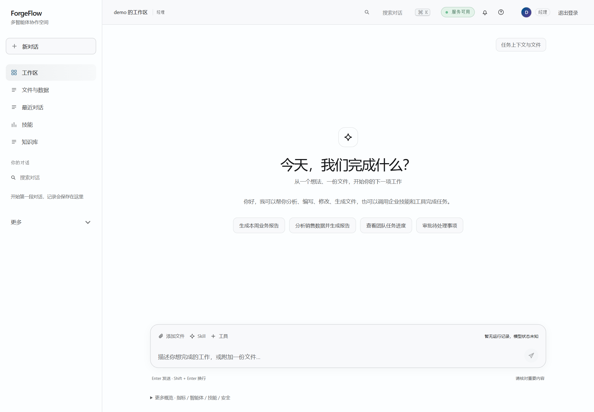
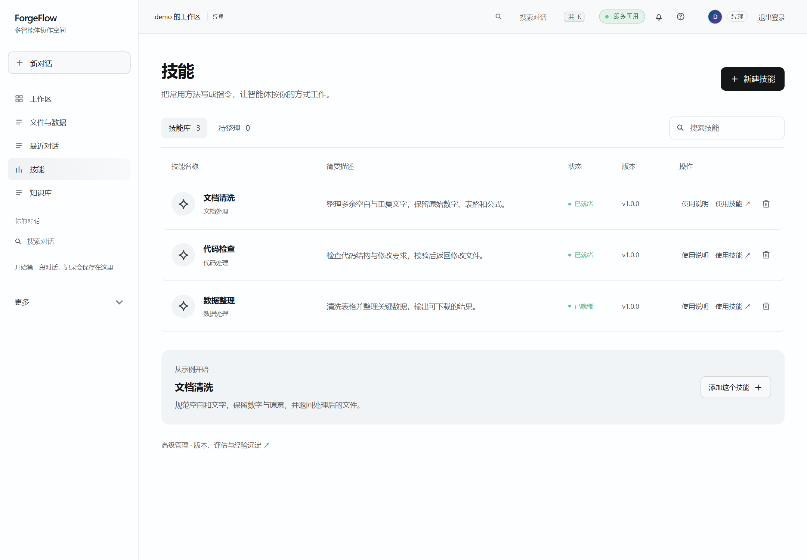
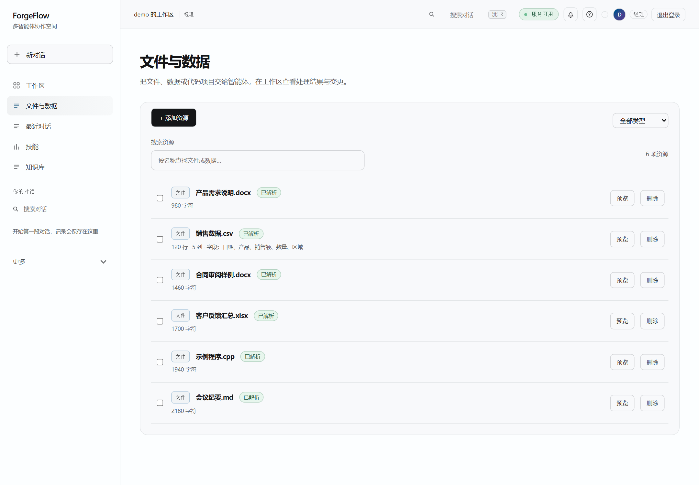
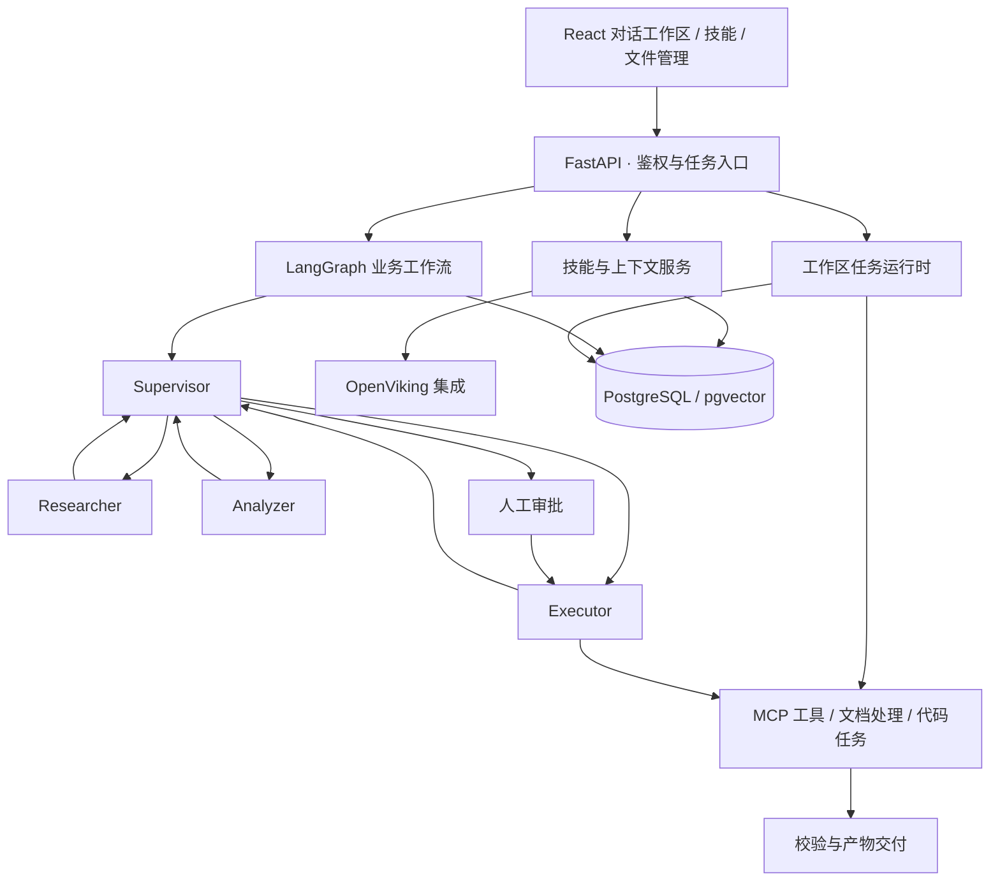

<div align="center">

# ForgeFlow

### 多智能体协作 · 技能管理 · 文档与代码任务

让任务从一句指令走向可检查、可追溯、可下载的结果。

[](https://github.com/fanfanfan333/forgeflow/actions/workflows/ci.yml)
[](pyproject.toml)
[](frontend/package.json)
[](forgeflow/graph/builder.py)
[](LICENSE)

[界面预览](#界面预览) · [核心能力](#核心能力) · [快速开始](#快速开始) · [技术架构](#技术架构) · [开发与验证](#开发与验证)

</div>



## 项目介绍

ForgeFlow 是基于 **LangGraph、MCP 与 FastAPI** 构建的多智能体应用平台。用户可以上传文件、选择技能、发起任务，在同一工作区查看执行过程、校验信息与输出文件，也可以基于历史对话继续处理。

项目将工具调用之外的工程问题纳入同一框架：技能如何复用，记忆如何检索，文件修改如何验证，高风险动作如何审批，以及不同租户的数据如何隔离。

**当前定位：持续迭代的工程参考实现。** 已实现能力与部署边界分开说明，不将模板工作流、演示数据或离线测试当作生产验收结果。

最近一次离线回归：3992 项通过；文件与技能页面浏览器回归：6 项通过。技能包导入保持草稿，资源读取不执行脚本。安全恢复、操作系统级代码隔离与完整真实模型对比仍待完成，详见[实施与验证记录](docs/quality/professional-agent-implementation-status.md)。

## 界面预览

截图来自本地运行的 React 界面，使用隔离的演示数据，不包含真实用户文件、对话或凭证。截图展示界面设计，不代表对应任务已通过真实模型执行验收。

<table>
  <tr>
    <td width="50%"><strong>技能中心</strong><br>以操作指令组织可复用能力，管理技能、版本与候选经验。</td>
    <td width="50%"><strong>文件与数据</strong><br>集中管理上传资源，按名称和类型查找、预览与选择文件。</td>
  </tr>
  <tr>
    <td><a href="docs/images/skills-preview.png"></a></td>
    <td><a href="docs/images/files-preview.png"></a></td>
  </tr>
</table>

## 核心能力

| 能力 | 实现方式 |
| :--- | :--- |
| **多智能体协作** | Supervisor 路由 Researcher、Analyzer 与 Executor，工作节点返回统一状态；结合检查点和人工审批组织流程。 |
| **Skill 能力体系** | 指令包装、试运行、版本管理和回滚；关键词与向量检索、RRF 融合及能力过滤；经验候选经过评估和发布流程后复用。 |
| **记忆与上下文** | 统一召回记忆、技能与任务经验，去重、排序并控制上下文预算；OpenViking 提供资源、技能和会话记忆的同步与检索集成。 |
| **文档与代码处理** | 支持文本、Word、Excel 的读取与编辑，以及代码任务；修改链路检查需求覆盖、结构和数据保留，产物支持预览与下载。 |
| **工具与业务连接** | MCP 统一工具调用；包含 HubSpot、Salesforce、Jira、ServiceNow、GitHub、SAP、QuickBooks 和 Microsoft Graph 等连接器。 |
| **权限与治理** | RBAC、审批、审计、出站请求防护，以及 PostgreSQL RLS 强制租户隔离；运行账户与迁移账户分离。 |

### 技能如何成为可复用能力

```text
任务经验 → 候选整理 → 明确输入、输出与边界 → 评估 / 审批 → 技能发布
                                                               ↓
新任务 → 权限与能力筛选 → 技能检索 → 工具执行 → 结果校验 → 文件交付
```

技能不是一句无限制的系统提示词。每个技能需要说明适用场景、操作步骤、成功标准和工具边界，并保留版本及来源记录。

## 技术架构



工作区任务运行时与命名业务工作流是不同入口；图中分别列出，避免把所有执行路径描述为同一套编排。

| 层级 | 技术 |
| :--- | :--- |
| 前端 | React 19、TypeScript、Vite、TanStack Query / Router |
| API 与编排 | Python、FastAPI、Pydantic、LangGraph |
| 工具与协议 | FastMCP、MCP、A2A |
| 模型 | Ollama 本地推理；mock 用于离线开发与测试 |
| 存储与记忆 | PostgreSQL、pgvector、OpenViking 集成 |
| 工程化 | pytest、Playwright、Ruff、mypy、Docker Compose、GitHub Actions |

## 快速开始

### 环境准备

- Docker 与 Docker Compose。
- 使用真实模型时，需要可访问的 Ollama 服务和已下载的模型。
- 本地开发需要 Python 3.11+；前端建议使用 Node.js 22.12+。

```bash
git clone https://github.com/fanfanfan333/forgeflow.git
cd forgeflow
cp .env.example .env
```

Windows PowerShell 可用 `Copy-Item .env.example .env` 完成配置复制。

启动前编辑 `.env`，至少设置：

| 配置 | 用途 |
| :--- | :--- |
| `POSTGRES_PASSWORD` | 数据库迁移账户密码。 |
| `POSTGRES_RUNTIME_PASSWORD` | 独立的低权限运行账户密码，不与迁移账户共用。 |
| `API_SECRET_KEY` | 随机签名密钥，替换示例值。 |
| `DEV_LOGIN_PASSWORD` | 本地演示登录密码，替换示例值。 |
| `LLM_PROVIDER` | 真实任务使用 `ollama`；仅验证离线界面与流程时可用 `mock`。 |
| `OLLAMA_BASE_URL` | 容器可以访问的 Ollama 地址。Docker Desktop 常用 `http://host.docker.internal:11434`。 |
| `OLLAMA_MODEL` / `OLLAMA_MODEL_STRONG` | 已在 Ollama 中下载、支持任务工具调用的模型名称。 |

没有配置 LangSmith 时，设置 `LANGCHAIN_TRACING_V2=false`。Linux 上宿主机模型地址需要单独配置网络；容器中的 `localhost` 不指向宿主机。

### 启动服务

```bash
docker compose up -d postgres
docker compose --profile migration run --rm migrate
docker compose up -d --build mcp_server api frontend
```

迁移步骤同时创建低权限运行账户。不要直接使用数据库管理员账户启动 API，以免绕过租户隔离。

| 入口 | 默认地址 |
| :--- | :--- |
| 对话与管理界面 | http://localhost:8501 |
| API 文档 | http://localhost:8000/docs |

开发登录启用时，可使用 `manager-1` 和自己配置的 `DEV_LOGIN_PASSWORD`。部署到共享环境前，应关闭开发登录并配置正式身份认证。

OpenViking 是单独配置的集成服务，基础 Compose 不会自动启动它。接入方式与其他环境变量见 [.env.example](.env.example) 和 [文档中心](docs/README.md)。

## 开发与验证

```bash
python -m venv .venv
# 激活虚拟环境后：
pip install -e ".[dev,ollama]"
cd frontend
npm ci
cd ..
make check-full
```

`make check-full` 汇总后端检查、已有 lint 债务门禁、API 契约检查、前端 lint / 构建与浏览器测试。需要外部服务的测试有独立环境要求；通过离线测试不代表真实模型或企业连接器已完成验收。详细命令见 [测试说明](docs/testing.md)。

## 项目结构

```text
forgeflow/
├── api/            API 与任务入口
├── graph/          LangGraph 编排
├── runtime/        工作区任务运行时
├── skills/         技能检索、评估与版本管理
├── context/        上下文预算与 OpenViking 集成
├── experience/     任务经验与上下文构建
├── documents/      文档处理与修改校验
├── mcp/            工具服务与客户端
├── connectors/     企业系统连接器
└── governance/     权限策略与执行治理
frontend/           React 应用
alembic/            数据库迁移
tests/              后端测试与测试样例
scripts/            开发、验证与运维工具
docs/               架构、部署与质量记录
```

## 能力边界

- 工作区执行以单 API 进程为当前运行约束。数据库检查点与事件持久化不等于已经完成分布式调度、跨实例取消和生产容灾验收。
- `sales_ops` 是已接线的参考工作流；`support_ops` 与 `finance_recon` 保留为模板，不能直接当作已验收的业务系统。
- 企业连接器的实际使用需要对应账号、凭证与沙箱验证。仓库包含实现，并不代表所有外部系统都已完成线上联调。
- 代码执行的隔离强度取决于配置的运行后端；当前不宣称具备 microVM 隔离。
- 安全控制与回归测试持续完善，具体已修复项和剩余限制见 [安全整改记录](docs/quality/security-audit-remediation-2026-10-10.md)。

## 文档与贡献

[架构说明](docs/architecture.md) · [文档中心](docs/README.md) · [测试说明](docs/testing.md) · [离线部署](docs/deployment/AIRGAPPED.md) · [贡献指南](CONTRIBUTING.md) · [安全策略](SECURITY.md)

采用 [Apache License 2.0](LICENSE)。
