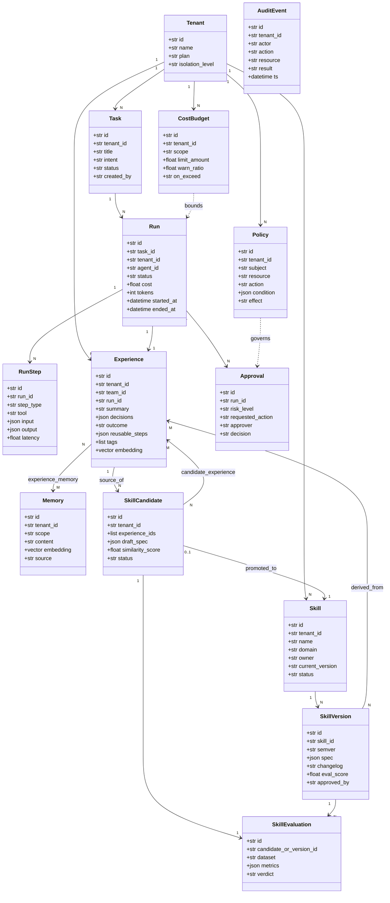
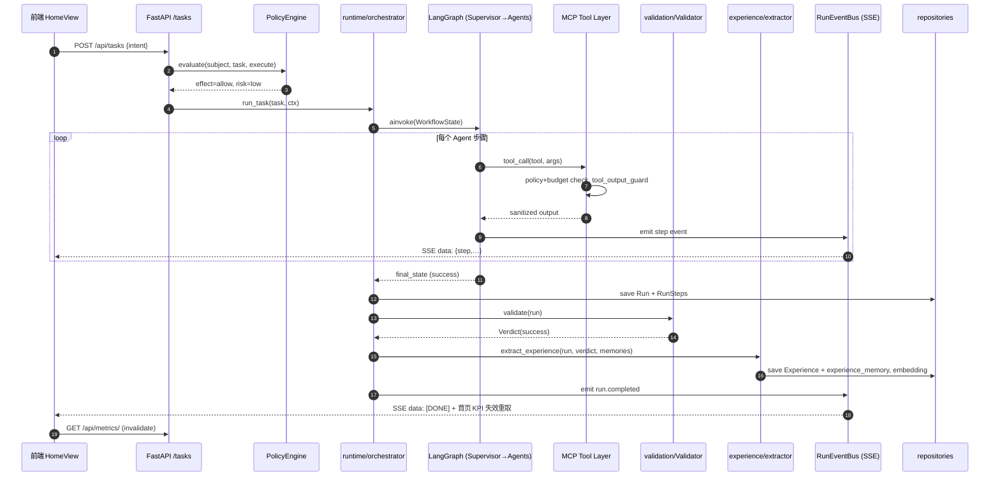
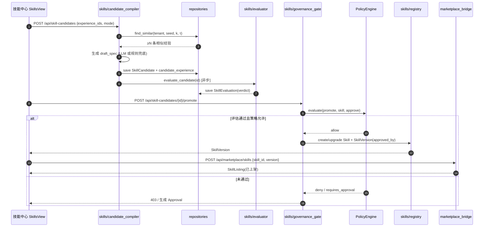
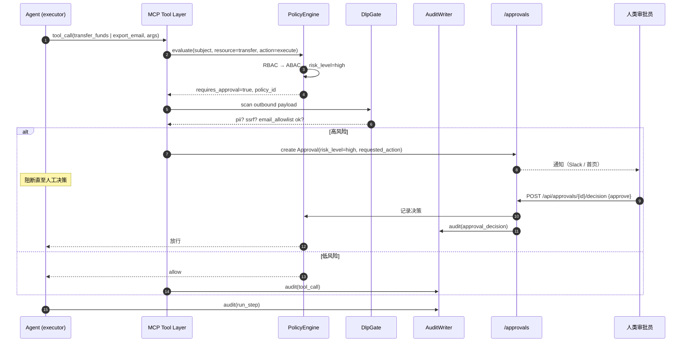

# AgentFlow · 系统架构设计（02-ARCHITECTURE）

> 2026-09-26 INC16：OpenAI/Anthropic provider 已移除，本节为历史记录。

> 版本：v1.0 ｜ 阶段：改造立项 ｜ 负责人：高见远（架构师）
> 输入：`docs/sop/01-PRD.md` v1.0（产品经理 许清楚）
> 基线：`ForgeFlow-main`（Apache-2.0；FastAPI + LangGraph + MCP + PostgreSQL/pgvector + React 19/Vite）

---

## 0. 三条强制架构约束（主理人裁决，优先级高于 PRD）

| # | 约束 | 落地方式 |
|---|---|---|
| C1 | **保持现有前端栈**：React 19 + Vite + TanStack Router + TanStack Query + 手写 CSS（oklch token）。**不得引入 MUI / Tailwind CSS**。 | 新页面复用 `frontend/src/styles/tokens.css` 的 CSS 变量与 `.card` / `.badge` / `.btn` / `.kpi` / `.panel` / `.navlink` 原子类；新增样式写在 `frontend/src/styles/*.css`。PRD 第 0 节的「MUI + Tailwind」为笔误，本设计以现状为准。 |
| C2 | **本机零外部依赖可运行**：RAM ~2.2GB 空闲、Python 依赖未装、Ollama 未运行、8000 端口被占。 | ① 数据访问走 **Repository 抽象 + 内存实现**，关键路径（Skill/Experience/Memory/Policy/Cost）无 PG 时可 import / 单测 / 跑通闭环演示；② LLM 经现有 `get_model()` 工厂，**新增 `mock` provider**；③ 新增能力不在 import 期强依赖可选包（保持 lazy-import）。 |
| C3 | **不破坏存量**：现有 43 个测试文件（unit 36 + integration 7）与现有 API 路径继续兼容。 | 改造以 **增量扩展** 为主：新路由与旧路由共存；`graph/builder.py`、`api/main.py` 现有签名不改；`ROUTE_PERMISSION_MAP` 只追加不删改；如需变更旧接口，见 §11 兼容性影响。 |

---

## 1. 架构总览：PRD 六层 → 现有 `forgeflow/` 包结构映射

### 1.1 映射对照表

> 路径均相对仓库根 `ForgeFlow-main/`。**新增子包 6 个**（标注 🆕），其余为扩展或复用。

| PRD 层 | 目标包 / 文件 | 处置 | 职责 |
|---|---|---|---|
| —（底座） | `forgeflow/repositories/` 🆕 | **新增** | 数据访问抽象：`base.py`(Protocol) + `memory/*.py`(内存实现) + `postgres/*.py`(Pg 实现) + `factory.py`(按 `STORAGE_BACKEND` 选择)。所有 Hub 只依赖此层，不直接写 SQL。 |
| Memory Hub（②⑦） | `forgeflow/experience/` 🆕 | **新增** | `Experience` 一等资产；五层记忆 scope（User/Team/Episodic/Semantic/Org）；`ExperienceExtractor`；`ContextBuilder`（P1）；`lineage` 追溯 |
| Memory Hub（向量） | `forgeflow/memory/` | **扩展** | 复用 `MemoryManager` / `PGVectorStore` / `RelationalStore`；新增 `scope`/`team_id` 过滤与 keyword 兜底检索 |
| Skill Hub（③④⑤⑥） | `forgeflow/skills/` 🆕 | **新增** | `SkillRegistry`；`SkillVersioning`(semver/changelog/diff/rollback)；**`SkillCandidateCompiler`（缺失的一环）**；`SkillGovernanceGate`；`SkillEvolutionAdvisor`(P2) |
| Security Hub（治理底座） | `forgeflow/governance/` 🆕 | **新增** | `PolicyEngine`（RBAC→ABAC→风险分级→HITL）；`TenantIsolation`（仓储基类行级过滤）；`DlpGate`（编排 `security/`）；`AuditWriter` |
| Security Hub（原子能力） | `forgeflow/security/`、`forgeflow/rbac/`、`forgeflow/middleware/` | **复用不改** | `pii_redactor` / `prompt_guard` / `ssrf_guard` / `tool_output_guard` / `email_allowlist`；`ROLE_PERMISSIONS`/`ROUTE_PERMISSION_MAP`/`RBACMiddleware`；中间件栈 |
| Agent Runtime（①） | `forgeflow/runtime/` 🆕 | **新增** | `PlatformRouter`（Supervisor→Research/Data/Code/Document/Security Agent 编排）；`RunEventBus`（SSE 广播）；`RunStore`；Replan 回环 |
| Agent Runtime（图原语） | `forgeflow/graph/`、`forgeflow/agents/`、`forgeflow/state/` | **扩展/复用** | 复用 `StateGraph`/`checkpointer`/`WorkflowState`；`runtime/` 在其上新增 `build_platform_graph()`，**不改** `builder.py` |
| Validation Layer（①②） | `forgeflow/validation/` 🆕 | **新增** | `Validator.validate(run)->Verdict`；Failure→Replan 触发；任务终态触发 `ExperienceExtractor` |
| MCP Tool Layer | `forgeflow/mcp/`、`forgeflow/connectors/` | **扩展** | 复用 14-tool router + client adapter；新增工具注册表与 Policy/预算前置检查；输出经 `tool_output_guard` |
| Cost / Resilience | `forgeflow/resilience/`、`forgeflow/observability/` | **扩展** | 复用 `budget_guard`/`retry`/`circuit_breaker`；新增 `CostBudget` 预算感知降级、SLO 分级 |
| Evaluation | `forgeflow/evaluation/` | **复用** | `judge`/`metrics`/`runner` 供 `validation/` 与 `skills/` 复用 |
| 门户/前端 | `frontend/src/**` | **扩展** | 路由/导航/首页重做；复用 `client.ts`/`hooks.ts`/`router.tsx` 模式 |
| 配置 | `forgeflow/config.py`、`forgeflow/models/provider.py` | **扩展** | 新增 settings 字段；`get_model()` 新增 `mock` 分支 |
| 迁移 | `alembic/versions/010_agentflow_hubs.py` 🆕 | **新增** | 13 实体 DDL，`down_revision="009"` |

### 1.2 目标架构图（含闭环与回边）

```mermaid
flowchart TB
  subgraph FE["门户 frontend/src (React19+Vite+TanStack)"]
    HOME["首页 HomeView<br/>KPI/Agent/Skill/日志/安全"]
    SKILLUI["技能中心 SkillsView"]
    MEMUI["记忆管理 MemoryView"]
    SECUI["安全与权限 SecurityView"]
    SSE["useRunEvents (EventSource /api/runs/:id/events)"]
  end

  subgraph API["配置层 forgeflow/api"]
    ROUTERS["routers/: tasks runs skills skill_candidates<br/>experiences memory policies approvals audit metrics"]
    MW["中间件栈: RBAC → RateLimit → Security → Audit → Headers"]
    DEP["dependencies: get_tenant_id / get_current_user"]
  end

  subgraph GOV["Security Hub — forgeflow/governance (🆕)"]
    PE["PolicyEngine<br/>RBAC → ABAC → risk_level → HITL"]
    TI["TenantIsolation (仓储基类行级过滤)"]
    DLP["DlpGate (pii_redactor/ssrf/email_allowlist)"]
  end

  subgraph RT["Agent Runtime — forgeflow/runtime (🆕)"]
    SUP["Supervisor"]
    RA["Research / Data / Code / Document / Security Agent"]
    BUS["RunEventBus (SSE)"]
    REPLAN["Replan Loop 回边"]
  end

  subgraph VLD["Validation Layer — forgeflow/validation (🆕)"]
    VAL["Validator.validate(run)->Verdict"]
  end

  subgraph TOOLS["MCP Tool Layer — forgeflow/mcp (扩展)"]
    MCPR["MCP router 14 tools + connectors 8"]
    TOG["tool_output_guard"]
  end

  subgraph HUBS["Memory Hub / Skill Hub"]
    EXP["forgeflow/experience (🆕)<br/>Experience + 五层 Memory + ContextBuilder"]
    SKL["forgeflow/skills (🆕)<br/>Registry / Versioning / CandidateCompiler / GovernanceGate"]
    REPO["forgeflow/repositories (🆕)<br/>内存实现 + PG 实现"]
    VEC["forgeflow/memory / pgvector (扩展)"]
  end

  HOME --> ROUTERS
  SKILLUI --> ROUTERS
  MEMUI --> ROUTERS
  SECUI --> ROUTERS
  BUS -.SSE.-> SSE
  ROUTERS --> MW --> DEP
  ROUTERS --> RT
  ROUTERS --> HUBS
  ROUTERS --> GOV
  SUP --> RA
  RA -->|tool call| MCPR
  MCPR --> TOG --> RA
  MCPR -.policy+budget.-> PE
  RA -->|final state| VAL
  VAL -->|success/failure| REPLAN
  REPLAN -.max retry-> HR{{HITL Approval}}
  HR --> PE
  PE -->|high risk| HR
  VAL -->|terminal| EXP
  EXP -->|≥N similar + 标记最佳实践| SKL
  SKL -->|Candidate| VLD
  VLD -->|verdict| SKL
  SKL -->|governance gate| PE
  PE -->|approved| SKL
  SKL -->|publish| MK["Marketplace (扩展)"]
  MK -.install/reuse.-> RT
  HUBS --> REPO
  EXP --> VEC
  REPO -.STORAGE_BACKEND=memory.-> MEMDB[("内存字典")]
  REPO -.STORAGE_BACKEND=postgres.-> PG[("PostgreSQL/pgvector :5433")]
  GOV --> REPO
  RT -. 复用 .-> GRAPH["forgeflow/graph + agents + state (复用)"]
```

---

## 2. 闭环实现设计（任务 → 经验 → Skill 逐跳）

> 命名约定：`tenant_id` 即为现有 `workspace_id`（见 §3 与 §11）。所有入口均为 `async`，除 mock 兜底路径外不在 import 期构造 DB/LLM。

| 跳 | 入口函数（签名） | 所在文件 | 触发方式 | 产物表 |
|---|---|---|---|---|
| ① 任务执行 | `async def run_task(task: TaskCreate, ctx: RequestContext) -> RunHandle` | `forgeflow/runtime/orchestrator.py` | API `POST /tasks`；或 LangGraph 入口节点 `runtime.entry` | `tasks`,`workflow_runs`(Run),`run_steps` |
| ② 经验提取 | `async def extract_experience(run: Run, verdict: Verdict, memories: list[Memory]) -> Experience` | `forgeflow/experience/extractor.py` | Validation 终态事件回调 `run.terminal`；或显式 API | `experiences`,`experience_memory`(N:M)，向量入 `memory_vectors` |
| ③ 候选编译（**缺失的一环**） | `async def compile_candidate(tenant_id: str, experience_ids: list[str] \| None = None, mode: str = "auto") -> SkillCandidate` | `forgeflow/skills/candidate_compiler.py` | API `POST /skill-candidates`（手动）；或相似度聚类达阈值（自动，经验落库后钩子） | `skill_candidates`,`candidate_experience`(N:M) |
| ④ 治理评估 | `async def evaluate_candidate(candidate_id: str, dataset: str \| None = None) -> SkillEvaluation` | `forgeflow/skills/evaluator.py` | 候选生成即入评估队列（`asyncio.create_task` / 后台 job）；或 API `POST /skill-candidates/{id}/evaluate` | `skill_evaluations` |
| ⑤ 固化与版本化 | `async def promote_candidate(candidate_id: str, actor: str) -> SkillVersion` | `forgeflow/skills/governance_gate.py` → `registry.py` | API `POST /skill-candidates/{id}/promote`（须评估通过 + Policy 审批） | `skills`,`skill_versions` |
| ⑥ 发布共享 | `async def publish_version(skill_id: str, version: str, actor: str) -> SkillListing` | `forgeflow/skills/marketplace_bridge.py` | owner 点击发布 → API `POST /marketplace/skills` | `skill_listings` + `marketplace` 注册表 |
| ⑦ 运行期复用再进化 | `SkillRegistry.select(tenant_id, intent, k) -> list[Skill]` 注入 ① 的 `ctx.available_skills` | `forgeflow/skills/registry.py` | Agent Runtime 选技能时 | 回 ①/②（新 Run + 新 Experience） |

### 2.1 跳③「缺失的一环」算法设计（Skill Candidate Compiler）

**目标**：把「若干相似经验」编译为「可复用技能草稿 spec」（prompt / steps / tools / io_schema / 适用条件）。

```
compile_candidate(tenant_id, experience_ids=None, mode="auto"):
  1) 取种子经验
     - mode="manual": experience_ids 由用户显式传入（≥1 条，UI「一键固化为技能」）
     - mode="auto"  : 从 tenant 内最新 Experience 起，检索其相似经验
  2) 相似经验获取
     - 首选（STORAGE_BACKEND=postgres）:
         ExperienceRepository.find_similar(tenant_id, seed_embedding, k=max(N, 10), min_similarity=τ)
         → SQL: SELECT ... , 1-(embedding <=> $1::vector) AS sim FROM experiences
                WHERE tenant_id=$2 AND sim >= τ ORDER BY embedding <=> $1 LIMIT $3
     - 兜底（STORAGE_BACKEND=memory）:
         内存实现遍历 dataclass 列表，用纯 Python 余弦相似度（numpy 不可用时用 math + 稀疏点积）
  3) 聚类闸门
     - 若 (len(similar) + 1) < N  → 返回 status="insufficient"（不足），不生成候选
     - N 与 τ 全部来自 Settings（见 §10）：SKILL_CANDIDATE_MIN_EXPERIENCES=3, SIMILARITY_THRESHOLD=0.85
  4) 草稿 spec 生成
     - LLM 路径: get_model(strong=True).with_structured_output(DraftSpec)  ← 输入=聚类经验的 summary/decisions/reusable_steps + run_steps 序列
     - 无 LLM / provider=mock 兜底（规则法，保证闭环可跑通）:
         prompt  ← 渲染模板 "为「{domain}」类任务生成可复用技能：{summary}\n关键决策：{decisions}"
         steps   ← 对聚类内各 run_steps 的 tool 序列求「最长公共有序子序列」，取出现频次 ≥ ceil(N/2) 的步骤
         tools   ← 聚类内 run_steps.tool 的并集
         io_schema ← 由各 run 的 input_data/output_data 的键集合推断 JSON Schema（type 依值推断）
         applicable_when ← 由 Experience.tags 与 domain 生成
  5) 落库
     - INSERT skill_candidates(status="draft", draft_spec, similarity_score=avg(sim))
     - INSERT candidate_experience(candidate_id, experience_id, similarity)   -- N:M
  6) 触发跳④  evaluate_candidate(candidate_id)（飞书/异步，不阻断请求）
```

**配置**：`N` 与 `τ` 均为 env 可调；`similarity_score` 取聚类平均；草稿 spec 的 `prompt` 允许人工编辑后再评估。

**响应示例**（`POST /skill-candidates`）：
```json
{ "candidate_id": "…", "status": "draft", "similarity_score": 0.88,
  "experience_ids": ["…","…","…"],
  "draft_spec": { "prompt": "…", "steps": ["…"], "tools": ["data.query"],
                  "io_schema": {"input": {...}, "output": {...}}, "applicable_when": {...} } }
```

---

## 3. 数据模型

### 3.1 实体映射（PRD 3.3 → 落地）

| PRD 实体 | 落地 | 说明 |
|---|---|---|
| `Tenant` | **复用** `workspaces` + 新增列 `plan`,`isolation_level` | Tenant ≡ 现有 workspace（口径统一，见 §11 偏差#5） |
| `Task` | **新增** `tasks` | 一次用户意图；1:N → Run |
| `Run` | **复用** `workflow_runs` + 新增 `task_id`,`agent_id` | 兼容现有读写；`Run ≡ workflow_runs` |
| `RunStep` | **新增** `run_steps` | 工具/步骤级轨迹（现有 `agent_traces` 为 agent 级，二者互补共存） |
| `Experience` | **新增** `experiences` | 一等资产；N:1 → Run，N:M → Memory |
| `Memory` | **复用/扩展** `memory_vectors` + 新增 `scope`,`team_id` | 五层 scope；N:M ↔ Experience |
| （关联表） | **新增** `experience_memory` | `Experience` × `Memory` 的 N:M（**分离但关联**） |
| `SkillCandidate` | **新增** `skill_candidates` | draft_spec JSONB；1:1 → evaluation；0:1 → Skill |
| （关联表） | **新增** `candidate_experience` | `SkillCandidate` × `Experience` N:M（来源追溯） |
| `Skill` | **新增** `skills` | 1:N → `skill_versions` |
| `SkillVersion` | **新增** `skill_versions` | semver + spec + changelog + eval_score + approved_by |
| `SkillEvaluation` | **新增** `skill_evaluations` | N:1 → candidate / version |
| `Policy` | **新增** `policies` | RBAC/ABAC 主体-资源-动作-条件-effect |
| `Approval` | **复用** `approval_requests` + 新增 `risk_level` | HITL |
| `AuditEvent` | **复用** `audit_log`（分区表） | 全量审计 |

> 设计要点：**Experience 与 Memory 分离**，通过 `experience_memory` 关联表建立 N:M；`tenant_id`（=workspace_id）出现在所有租户域表（`tasks`/`run_steps`/`experiences`/`skill_candidates`/`skills`/`skill_versions`/`policies`…）。

### 3.2 Alembic 迁移

- 文件名：`alembic/versions/010_agentflow_hubs.py`
- `revision = "010"`，`down_revision = "009"`（承接现有 head `009_auth_users.py`）
- `upgrade()` 新建上述表 + `ALTER` 扩展 `workspaces`/`workflow_runs`/`memory_vectors`/`approval_requests`
- `downgrade()` 逆向删除；全部使用 `CREATE TABLE IF NOT EXISTS` / `ADD COLUMN IF NOT EXISTS`，可重入

关键 DDL（节选，实际实现详见任务 T04）：

```sql
-- Experience（一等资产）
CREATE TABLE IF NOT EXISTS experiences (
  id            UUID PRIMARY KEY DEFAULT gen_random_uuid(),
  tenant_id     UUID,
  team_id       UUID,
  run_id        UUID NOT NULL REFERENCES workflow_runs(id) ON DELETE CASCADE,
  summary       TEXT NOT NULL,
  decisions     JSONB  NOT NULL DEFAULT '[]',
  outcome       VARCHAR(16) NOT NULL,            -- success | failure | aborted
  reusable_steps JSONB NOT NULL DEFAULT '[]',
  tags          TEXT[] NOT NULL DEFAULT '{}',
  embedding     vector(1536),
  created_at    TIMESTAMPTZ NOT NULL DEFAULT now()
);
CREATE INDEX IF NOT EXISTS idx_experiences_tenant ON experiences(tenant_id);
CREATE INDEX IF NOT EXISTS idx_experiences_embedding ON experiences
  USING ivfflat (embedding vector_cosine_ops) WITH (lists = 100);

-- N:M — Experience ↔ Memory
CREATE TABLE IF NOT EXISTS experience_memory (
  experience_id UUID NOT NULL REFERENCES experiences(id) ON DELETE CASCADE,
  memory_id     UUID NOT NULL,
  relation      VARCHAR(16) NOT NULL DEFAULT 'source',
  PRIMARY KEY (experience_id, memory_id)
);

-- Skill + 版本
CREATE TABLE IF NOT EXISTS skills (
  id UUID PRIMARY KEY DEFAULT gen_random_uuid(),
  tenant_id UUID, name VARCHAR(128) NOT NULL, domain VARCHAR(64) NOT NULL,
  owner VARCHAR(128), current_version VARCHAR(32),
  status VARCHAR(16) NOT NULL DEFAULT 'draft',   -- draft|evaluating|published|retired
  created_at TIMESTAMPTZ NOT NULL DEFAULT now(), UNIQUE (tenant_id, name)
);
CREATE TABLE IF NOT EXISTS skill_versions (
  id UUID PRIMARY KEY DEFAULT gen_random_uuid(),
  skill_id UUID NOT NULL REFERENCES skills(id) ON DELETE CASCADE,
  semver VARCHAR(32) NOT NULL, spec JSONB NOT NULL DEFAULT '{}',
  changelog TEXT, eval_score DOUBLE PRECISION,
  source_experience_ids UUID[] NOT NULL DEFAULT '{}',
  approved_by VARCHAR(128), created_at TIMESTAMPTZ NOT NULL DEFAULT now(),
  UNIQUE (skill_id, semver)
);
```

### 3.3 内存实现数据结构（无 PG 可跑）

`forgeflow/repositories/memory/` 用 dataclass 承载，字段与表一一对应：

```python
@dataclass
class ExperienceRecord:
    id: str; tenant_id: str | None; team_id: str | None; run_id: str
    summary: str; decisions: list[dict]; outcome: str
    reusable_steps: list[dict]; tags: list[str]
    embedding: list[float] | None; created_at: datetime
    memory_ids: list[str]          # 承载 N:M
```

- 存储：模块级 `dict[str, ...]` 以 `tenant_id` 分区（`dict[tenant_id, dict[id, rec]]`），进程内单例，线程安全用 `asyncio.Lock`。
- 相似度：`math` 手写余弦（不引入 numpy）；embedding 缺席时退化为标签精确匹配 + 关键词包含。
- 语义：与 PG 实现**接口完全一致**（同一 Protocol），可无缝切换 `STORAGE_BACKEND`。

---

## 4. 接口设计（REST）

> **路由挂载约定（关键，已核对现状）**：后端 `api/main.py` 把各 router 挂在 **根路径**（`/workflows`、`/memory`、`/auth`…）；`/api/*` 是 **前端访问前缀**——dev 由 `vite.config.ts` 代理 `rewrite: path.replace(/^\/api/,'')`，prod 由 `nginx` `location /api/ → proxy_pass http://api:8000/`（尾斜杠剥前缀）。因此：
> - **后端实现路径** = 下表「路径」列（根路径）；
> - **前端调用路径** = `/api` + 下表路径（如 `/api/skills`）。
> - PRD 第 6 章的 `/api/skills` 等写法**均为前端视角且正确**；本设计据此把后端 router 挂到根路径 `/skills`，前端经 `/api/skills` 访问。**以现状为准**。

### 4.1 新增 / 变更端点

> 权限列为需追加到 `forgeflow/rbac/policies.py::ROUTE_PERMISSION_MAP` 的 `action:resource`；该 Map **fail-closed**，未登记即 403。Policy Engine 列标注是否额外经 `POST /policies/evaluate` 决策。

| 方法 | 路径（后端） | 请求 schema | 响应 schema | 权限 | Policy Engine |
|---|---|---|---|---|---|
| POST | `/tasks` | `TaskCreate{intent, workflow_type?, context}` | `RunHandle{run_id, thread_id, status}` | `execute:workflows` | 是（入口风险分级） |
| GET | `/runs/{run_id}` | — | `RunDetail` | `read:workflows` | 否（对象级校验复用现有 `_assert_can_read_run`） |
| GET | `/runs/{run_id}/events` | — | `text/event-stream` | `read:workflows` | 否 |
| POST | `/runs/{run_id}/replan` | `{reason?}` | `RunHandle` | `execute:workflows` | 是 |
| GET | `/skills` | query: `domain, q, limit, offset, featured` | `SkillList{total, items[]}` | `read:skills` | 否 |
| POST | `/skills` | `SkillCreate{name, domain, owner, description}` | `Skill` | `write:skills` | 是 |
| GET | `/skills/{id}/versions` | — | `SkillVersion[]` | `read:skills` | 否 |
| POST | `/skills/{id}/versions` | `SkillVersionCreate{semver, spec, changelog}` | `SkillVersion` | `write:skills` | 是 |
| POST | `/skills/{id}/rollback` | `{to_version}` | `Skill` | `write:skills` | 是 |
| GET | `/skill-candidates` | query: `status, limit, offset` | `SkillCandidateList` | `read:skills` | 否 |
| POST | `/skill-candidates` | `{experience_ids?, mode?}` | `SkillCandidate` | `write:skills` | 是 |
| POST | `/skill-candidates/{id}/evaluate` | `{dataset?}` | `SkillEvaluation` | `write:skills` | 是 |
| POST | `/skill-candidates/{id}/promote` | `{actor?}` | `SkillVersion` | `approve:skills` | 是（治理闸门） |
| GET | `/experiences` | query: `outcome, tag, run_id, limit, offset` | `ExperienceList` | `read:memory` | 否 |
| POST | `/experiences` | `ExperienceCreate` | `Experience` | `write:memory` | 否 |
| GET | `/experiences/{id}/lineage` | — | `{experience, run, memories[]}` | `read:memory` | 否 |
| GET | `/memory` | query: `scope, team_id, limit, offset` | `MemoryList` | `read:memory` | 否 |
| POST | `/memory` | `MemoryCreate{scope, content, team_id?, metadata?}` | `Memory` | `write:memory` | 是（DLP） |
| POST | `/memory/search` | `{q, k?, scope?, namespace?}` | `MemoryResult[]` | `read:memory` | 否 |
| GET | `/context/build` *(P1)* | query: `intent, budget_tokens` | `ContextBundle` | `read:memory` | 否 |
| GET | `/policies` | query: `subject?, resource?` | `PolicyList` | `read:policies` | 否 |
| POST | `/policies` | `PolicyCreate{subject, resource, action, condition?, effect}` | `Policy` | `write:policies` | 是 |
| POST | `/policies/evaluate` | `EvalRequest{subject, resource, action, context}` | `EvalDecision{effect, risk_level, hit_policy_id?, requires_approval}` | `read:policies` | —（即引擎本身） |
| GET | `/approvals` | query: `status, risk_level?` | `Approval[]` | `read:proposals` | 否 |
| POST | `/approvals/{id}/decision` | `{decision: approve\|reject, note?}` | `Approval` | `approve:proposals` | 是（写审计） |
| GET | `/audit` | query: `tenant_id?, action?, from?, to?, limit, offset` | `AuditSearchResponse` | `read:audit` | 否 |
| GET | `/marketplace/skills` | query: `q, domain, limit, offset` | `SkillListing[]` | `read:marketplace` | 否 |
| POST | `/marketplace/skills` | `{skill_id, version, description}` | `SkillListing` | `write:marketplace` | 是（发布前可信基线，P1） |
| GET | `/security/overview` | — | `SecurityOverview` | `read:audit` | 否（首页安全概览聚合） |

**变更的旧端点（兼容）**：`POST /memory/store`（保留）、`GET /memory/search`（保留）；新增列不影响现有响应。`ROLE_PERMISSIONS` 新增权限（`read:skills`/`write:skills`/`approve:skills`/`read:policies`/`write:policies`）授予 `admin`(`*:*` 已覆盖)、`manager`、`sales_rep`(只读 skills) 等，**不删除**任何现有权限。

---

## 5. 类图 + 时序图（Mermaid）

### 5.1 类图（核心实体）



### 5.2 时序图 1 — 一次成功任务全链路



### 5.3 时序图 2 — 经验 → Skill Candidate → 评估 → 治理 → 版本发布



### 5.4 时序图 3 — 高风险操作触发 HITL + Policy 决策 + 审计



---

## 6. 安全设计

### 6.1 Tenant Isolation（行级）
- **实现层次**：`forgeflow/repositories/base.py::TenantScopedRepository` 基类——所有查询方法强制注入 `tenant_id` 条件（PG 实现拼 SQL 时加 `WHERE tenant_id = $1`；内存实现先按 `dict[tenant_id]` 分区）。
- **上下文获取**：`forgeflow/api/dependencies.py::get_tenant_id(request)` 从 `request.state.workspace_id`（中间件已从 JWT `workspace` claim 解析）读取，作为显式参数下传（**显式优先，便于单测**）；同时 `governance/context.py` 提供 `ContextVar` `current_tenant` 兜底默认值。
- **越权**：跨租户查询命中不到 → 返回 404（不泄露存在性，沿用现有 memory router 语义）；写操作跨租户 → 403。
- **复用**：现有 `memory` router 的 `_namespace_prefix` 校验逻辑上移为基类能力，行为兼容。

### 6.2 DLP 检查点
| 检查点 | 位置 | 复用 | 动作 |
|---|---|---|---|
| 入站请求体 | `SecurityMiddleware` | 现有 | 提示注入 HIGH → 400 |
| 工具输出入上下文 | `mcp` 调用后 | `tool_output_guard.sanitize_tool_output` | 包裹 `<UNTRUSTED_TOOL_OUTPUT>` + HIGH 脱敏 |
| 外发（邮件/HTTP） | `governance/dlp.py::DlpGate` | `pii_redactor.redact` + `email_allowlist` + `ssrf_guard` | PII/敏感外发拦截 + 告警 + 审计 |
| 记忆/经验落库前 | `experience/extractor` + `/memory` 写 | `pii_redactor` | 脱敏后落库 |
| Skill 发布前（P1） | `governance_gate` | 可信基线校验（工具白名单/越权/PII） | 不通过禁发布 |

### 6.3 Policy Engine 决策流程
```
evaluate(subject, resource, action, ctx) ->
  ① RBAC: ROLE_PERMISSIONS[role] 是否含 action:resource  → 否 → deny(403)
  ② ABAC: 逐条 policies.condition 求值（属性/环境）      → 不满足 → deny
  ③ 风险分级: risk = classify(resource, action, ctx)     → low/medium/high
  ④ HITL:   high → requires_approval=True（生成 Approval，阻断）
  ⑤ 返回 EvalDecision{effect, risk_level, hit_policy_id, requires_approval}
  ⑥ AuditWriter.audit(decision)
```
- 默认规则集（可配）：破坏性写（delete/drop）、资金（transfer/pay）、外发（email/http post 外部）→ **high**；读类 → low；批量写 → medium。
- 复用：`rbac/enforcer.py`、`middleware/audit.py`。

### 6.4 Prompt Injection 与工具输出隔离
完全复用现有 `security/prompt_guard.py`（入站扫描）与 `security/tool_output_guard.py`（二次注入防护 + 20k 截断 + `<UNTRUSTED_TOOL_OUTPUT>` 信封）；新增 MCP 工具调用必须经过 `tool_output_guard`，与现有 researcher/executor 行为一致。

---

## 7. 前端架构

### 7.1 路由表（新导航 10 项 → 路由 → 复用/新建）

| # | 导航项 | 路由路径 | 复用视图 | 新建视图 | 新建 CSS |
|---|---|---|---|---|---|
| 1 | 首页 | `/console` | — | `views/HomeView.tsx` | `styles/home.css` |
| 2 | 智能任务 | `/console/tasks` | `LiveRunsView`, `RunSalesOpsDialog` | `views/TasksView.tsx` | `styles/tasks.css` |
| 3 | Agent 工作台 | `/console/agents` | `AgentsView`（扩展 6 Agent 卡） | — | 复用 `dashboard.css` |
| 4 | 技能中心 | `/console/skills` | — | `views/SkillsView.tsx` | `styles/skills.css` |
| 5 | 知识库 | `/console/knowledge` | `MarketplaceView` | `views/KnowledgeView.tsx` | `styles/knowledge.css` |
| 6 | 记忆管理 | `/console/memory` | `MemoryView`（扩展 Experience + 五层） | — | 复用 `dashboard.css` |
| 7 | 数据分析 | `/console/analytics` | `CostView` | `views/AnalyticsView.tsx` | 复用 `dashboard.css` |
| 8 | 安全与权限 | `/console/security` | `RbacView`,`AuditView`,`ApprovalsView` | `views/SecurityView.tsx` | `styles/security.css` |
| 9 | 运维监控 | `/console/ops` | `WorkflowsView`,`EvaluationsView`,`ClustersView`,`ToolsView` | `views/OpsView.tsx` | 复用 `dashboard.css` |
| 10 | 系统设置（可展开） | `/console/settings` | — | `views/SettingsView.tsx`（子tab：用户与角色/策略配置/审计导出） | `styles/settings.css` |

- **兼容**：现有 `/console/runs`、`/console/marketplace`、`/console/cost` 等路由**保留**（旧书签/测试不破）；新导航与其并存，Sidebar 以新 10 项为主，旧项归入对应 Hub 子入口。
- 路由注册：扩展 `router.tsx` 的 `consoleChildren` 与 `components/Sidebar.tsx::ViewId` 联合类型（**追加**新 id，不删旧 id）。

### 7.2 `AppShell` / `Sidebar` 改造点
- `Sidebar.tsx`：`ViewId` 追加 `home|tasks|skills|knowledge|analytics|security|ops|settings`；`OBSERVE/BUILD/OPERATE` 三组重组为设计稿的 10 项主分组；品牌区文案改 `AgentFlow` / `Enterprise AI Workforce OS`；`系统设置` 支持子项展开。
- `AppShell.tsx`：`VIEW_TITLES` / `VIEW_PATHS` 追加新键；右栏信息区留给首页内部布局（在 `HomeView` 内实现三栏，不改 `AppShell` 骨架）。
- `Topbar.tsx`：占位符文案改为设计稿（`搜索任务、Agent、技能、知识库…`），`⌘K` 徽标保留。

### 7.3 首页数据来源（4 KPI / 6 Agent / 4 技能 / 近期任务 / 执行日志 / 安全概览）

| 区块 | 数据源 API（前端路径） | Hook |
|---|---|---|
| 4 KPI 卡 | `/api/metrics/`（总任务数、成功率、平均响应时间）+ `/api/metrics/cost`（节省成本） | `useMetricsSummary`, `useCostSummary`(新) |
| 6 Agent 卡 | `/api/agents/` | `useAgents` |
| 4 技能卡 | `/api/skills?featured=true&limit=4` | `useFeaturedSkills`(新) |
| 近期任务 | `/api/metrics/runs?limit=5` | `useRecentRuns(5)` |
| 智能执行日志 | SSE `/api/runs/{id}/events`（无活跃 run 时用 `/api/metrics/runs` 补历史） | `useRunEvents`(新) |
| 安全概览 | `/api/security/overview`（隔离/加密/权限状态 + 拦截计数） | `useSecurityOverview`(新) |

### 7.4 SSE 接入点与 Hook 设计
- 新增 `frontend/src/api/sse.ts`：`subscribeRunEvents(runId, onEvent, onDone): () => void`，基于 `EventSource('/api/runs/'+runId+'/events')`，含重连与 `[DONE]` 收尾；鉴权通过 query 传 token（EventSource 不支持自定义头）或复用现有 `POST /workflows/stream`（fetch + ReadableStream）。
- 新增 `hooks/useRunEvents.ts`：封装为 TanStack 友好 hook，收到事件时 `queryClient.setQueryData` 增量更新日志时间线；`onDone` 触发 `invalidateQueries`。
- 复用 `src/api/client.ts`（`BASE='/api'` + `request<T>`）与 `hooks.ts` 的 `refetchInterval` 轮询模式（SSE 不可用时降级为轮询，符合 SLO 降级约定）。

---

## 8. 本机运行方案

### 8.1 目录与端口约定
| 项 | 约定 |
|---|---|
| 项目根 | `D:\Agent项目\企业级 Multi-Agent 智能工作与技能资产平台\ForgeFlow-main` |
| venv | `D:\...\ForgeFlow-main\.venv`（放 D 盘） |
| 后端 API | **8010**（`API_PORT=8010`；8000 被占） |
| MCP Server | **8001**（`MCP_SERVER_PORT=8001`） |
| 前端 dev | **5173**（`vite` 默认） |
| PostgreSQL/pgvector | **5433**（`docker-compose` 映射 `5433:5432`；5432 被占） |

### 8.2 venv 与依赖安装
```bash
# 1) 建 venv（托管 Python 3.13.12）
C:\Users\18769\.workbuddy\binaries\python\versions\3.13.12\python.exe -m venv D:\...\ForgeFlow-main\.venv

# 2) 装依赖（离线优先，用本地 wheel 缓存 / 内网源）
D:\...\ForgeFlow-main\.venv\Scripts\python.exe -m pip install -e ".[dev]"

# 3) 前端依赖（裸 npm 不可用，必须走 node 入口）
node <NODE_DIR>\node_modules\npm\bin\npm-cli.js --prefix D:\...\ForgeFlow-main\frontend install
```

### 8.3 docker-compose 需改动行（若用容器跑 PG，仅此一项即可）
| 文件 | 行 | 现值 | 改为 |
|---|---|---|---|
| `docker-compose.yml` | `postgres.ports` | `"5432:5432"` | `"5433:5432"` |
| `docker-compose.yml` | `api.ports` | `"8000:8000"` | `"8010:8000"` |
| `docker-compose.yml` | `api.environment.API_PORT` | 缺省 8000 | 追加 `API_PORT: "8010"`（uvicorn `--port 8010`） |
| `docker-compose.yml` | `frontend.ports` | `"8501:80"` | `"5173:80"`（本机 dev 用 5173） |

> 也可**完全不改**：本机 dev 只用 `docker run -p 5433:5432 pgvector/pgvector:pg16` 起 PG，其余用 venv + vite 原生跑。

### 8.4 离线 / 降级运行路径（不启 PG、不启 Ollama）
```
.env（本机演示）:
  LLM_PROVIDER=mock            # 新增 provider，全程无报错
  STORAGE_BACKEND=memory       # Repository 内存实现，无 PG
  EVENTS_PROVIDER=none
  EMBEDDING_PROVIDER=mock      # 返回 1536 维确定性向量或 None
  DLP_ENABLED=true
```
- 该配置下：`import forgeflow.api.main` 成功；`pytest tests/unit` 全绿；`POST /api/tasks` → 闭环 → `Experience` → `SkillCandidate`（规则兜底草稿）→ 评估 → promote 全链路可演示。
- **无 LLM 能力边界**：草稿 spec 由规则法生成（质量有限），评估用 `evaluation/metrics` 的确定性指标（faithfulness 等 LLM judge 退化为启发式打分）。真实语义质量需 OpenAI/Anthropic/Ollama。

---

## 9. 依赖包清单

### 9.1 Python（**能不加就不加**）
| 包 | 状态 | 说明 |
|---|---|---|
| `langgraph`, `langchain-core`, `fastapi`, `uvicorn`, `asyncpg`, `psycopg[binary]`, `pgvector`, `alembic`, `pydantic`, `pydantic-settings` | 已存在 | 复用 |
| `langchain-openai` | 已存在 | 复用（embedding/mock 之外的 provider） |
| **无新增必装依赖** | — | 内存实现仅用标准库（`math`/`dataclasses`/`asyncio`）；mock provider 复用 `langchain_core.language_models.fake`（或自写 stub） |

### 9.2 npm
| 包 | 状态 | 说明 |
|---|---|---|
| `react`, `@tanstack/react-router`, `@tanstack/react-query`, `vite` | 已存在 | 复用 |
| **无新增依赖** | — | SSE 用浏览器原生 `EventSource`；图表复用现有 SVG 手绘（如 `OverviewView`）；不复用 MUI/Tailwind |

---

## 10. 共享知识（跨文件约定）

### 10.1 命名规范
- 新子包：`forgeflow/{repositories,experience,skills,governance,runtime,validation}/`
- 文件：小写下划线；类 PascalCase；路由文件与 `api/routers/` 现有风格一致。
- DB 表：小写复数下划线（`skill_candidates`）；列 snake_case；时间列 `*_at` TIMESTAMPTZ。
- 前端：视图 `XxxView.tsx`，样式 `xxx.css`，hook `useXxx.ts`。

### 10.2 错误类型
- 沿用 FastAPI `HTTPException`（400/403/404/409/422/503）；领域异常放各子包 `errors.py`（如 `InsufficientExperiencesError`），由 router 转 `HTTPException`。
- 未映射路由由 `RBACMiddleware` fail-closed → 403（新路由**必须**登记 `ROUTE_PERMISSION_MAP`）。

### 10.3 配置项命名（新增 env var + 默认值）
| env var | 默认 | 用途 |
|---|---|---|
| `LLM_PROVIDER` | `openai`（本机设 `mock`） | 新增枚举值 `mock` |
| `STORAGE_BACKEND` | `postgres`（本机设 `memory`） | `postgres` \| `memory` |
| `EMBEDDING_PROVIDER` | `openai`（本机设 `mock`） | `openai` \| `mock` |
| `SKILL_CANDIDATE_MIN_EXPERIENCES` | `3` | 跳③ 阈值 N |
| `SKILL_CANDIDATE_SIMILARITY_THRESHOLD` | `0.85` | 跳③ 相似度 τ |
| `TENANT_ISOLATION_LEVEL` | `row` | `row` \| `schema` |
| `DEFAULT_TENANT_ID` | `default` | 无 workspace claim 时的兜底租户 |
| `MAX_REPLAN_ATTEMPTS` | `2` | Replan 上限，超限转 HITL |
| `DLP_ENABLED` | `true` | DLP 总开关 |
| `SKILL_FEATURED_LIMIT` | `4` | 首页技能卡数量 |

### 10.4 日志/审计写入规范
- 应用日志：`logging.getLogger(__name__)`，格式沿用 `main.py` 的 basicConfig。
- 审计：所有策略决策/工具调用/审批/跨租户拦截写 `audit_log`；`governance/audit_writer.py` 统一封装，字段对齐现有 `AuditRow`（user_id/role/action/resource/outcome/request_id/metadata）。

### 10.5 tenant 上下文传递
- **显式参数优先**：`async def repo.list(tenant_id: str, ...)`；router 经 `Depends(get_tenant_id)` 取。
- **ContextVar 兜底**：`forgeflow/governance/context.py::current_tenant`，仅在跨层调用不便显式透传时读取默认值。**不**依赖全局可变状态做隔离决策。

### 10.6 时间与 ID 生成
- 时间：统一 `datetime.now(UTC)`（ISO 8601 UTC 存储），DB 列 TIMESTAMPTZ。
- ID：UUID v4 字符串；内存实现同样用 `uuid.uuid4()` 以保证与 PG 语义一致。

---

## 11. 风险与权衡（≥6）

| # | 风险 | 影响 | 缓解 |
|---|---|---|---|
| R1 | **Python 3.13 与 langgraph/pgvector/psycopg 兼容性**：部分依赖可能无 3.13 预编译 wheel，需源码编译（慢/失败） | 装依赖失败，本机跑不起来 | 优先用 `pgvector/pgvector:pg16` 容器跑 PG；Python 侧锁定已适配 3.13 的版本；必要时降级 3.12 venv（配置项化） |
| R2 | **RAM 仅 ~2.2GB 空闲**：无法并行跑 PG + MCP + API + vite build + 大模型 | OOM / 卡死 | 本机默认 `STORAGE_BACKEND=memory` + `LLM_PROVIDER=mock`；单进程后端；构建与运行分时 |
| R3 | **存量 43 测试兼容**：新 RBAC 条目、新迁移、新 router 可能影响既有断言 | 回归失败 | 增量扩展：不改 `builder.py`/`main.py` 签名；`ROUTE_PERMISSION_MAP` 只追加；新迁移可重入；`runtime/` 独立于 `graph/` |
| R4 | **无 LLM 能力边界**：mock 下语义质量差、judge 退化 | 演示可通、真实效果弱 | 规则兜底算法保证闭环；文档标注边界；真实 provider 一旦可用即切换（provider 可插拔） |
| R5 | **端口 8000 被占 / CORS**：新后端必须 8010，`cors_origins` 需含 5173 | 前端 401/CORS 报错 | `API_PORT=8010`；`.env` 设 `CORS_ALLOW_ORIGINS=http://localhost:5173` |
| R6 | **pgvector 维度不一致**：现有 embedding=1536；mock 向量维度若不同 | 相似检索报错/无结果 | mock embedding 固定 1536 维；不一致时检索层降级为关键词匹配（返回相似度=0 保底） |
| R7 | **多租户 N:M 迁移复杂度**：`workflow_runs.workspace_id` 仍可 NULL（存量单租户窗口） | 新表 join 出现 NULL 租户行 | 新增表 `tenant_id` 允许 NULL 并沿用现有「NULL=legacy/global」语义；提供 `DEFAULT_TENANT_ID` 回填脚本（P1） |
| R8 | **Skill 治理闸门强度未定（PRD Q2）** | 审批流程返工 | 本设计默认「普通技能 owner 审批，安全/财务类双人复核」，策略可配；标注为待确认 |

---

## 12. PRD 与现状不一致之处（重要，已按现状裁决）

| # | PRD 表述 | 现状事实 | 本次处理 |
|---|---|---|---|
| 1 | 前端「MUI + Tailwind CSS」 | 实际 React19/Vite/TanStack + 手写 oklch CSS，`package.json` 无 MUI/Tailwind | **保持现状**（约束 C1），PRD 节 0 视为笔误 |
| 2 | 接口路径写作 `/api/skills`、`/api/tasks` 等 | 后端 router 挂**根路径**；`/api` 仅是 dev(vite)/prod(nginx) 的**代理前缀** | 后端实现 `/skills`、`/tasks`…；前端调 `/api/*`；PRD 写法为「前端视角」且成立，文档统一标注 |
| 3 | 运行时接口 `POST /tasks` | 现有运行为 `POST /workflows/run`（同步、按 workflow_type 分派） | **新增** `/tasks` 与 `/runs/*`，`/workflows/*` **保留兼容** |
| 4 | 表 `runs`、`run_steps` | 现有 `workflow_runs`、`agent_traces` | Run ≡ `workflow_runs`（扩展）；新增 `run_steps`；`agent_traces` 保留 |
| 5 | 实体 `Tenant` | 现有 `workspaces` | Tenant ≡ workspace（`tenant_id`=`workspace_id`）；`workspaces` 增列 `plan`/`isolation_level` |
| 6 | Memory Hub `GET/POST /api/memory`（列表） | 现有 memory router 仅 `POST /store`、`GET /search`、`DELETE /{id}` | 新增 `GET /memory`（列表）、`POST /memory`（别名 store） |
| 7 | Agent 六类（Planner/Data/Code/Research/Document/Security） | 现有 agents：supervisor/researcher/analyzer/executor | `runtime/` 新增映射与新 agent 角色；保留现有四类兼容 |
| 8 | 迁移基线未提 | 现有 head = `009_auth_users.py` | 新迁移 `010_agentflow_hubs.py`，`down_revision="009"` |

---

> 交接说明：本文档的落地顺序见 `docs/sop/03-TASKS.md`。P0 关键路径为「T01 基础设施 → T04 迁移 → T05 Repository → T06/T07/T08 闭环服务 → T11 API → T13 前端首页 → T14 集成验收」。
