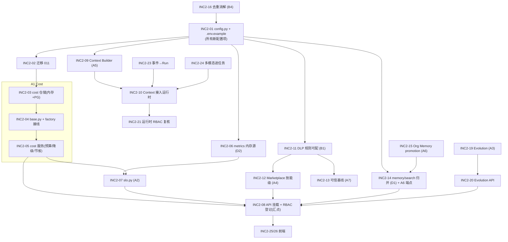

# AgentFlow · 增量架构设计（INC2）— 05-ARCHITECTURE-INC2

> 版本：v1.2（§7 六条裁决经主理人逐条批准 + 7.1/7.4/7.6 补充约束 · 2026-09-23）｜ 负责人：高见远（架构师）
> 输入：`docs/sop/01-PRD.md`（P1/P2 池）、`docs/sop/04-QA-REPORT.md`（遗留项）、主理人 INC2 任务书第三节
> 基线：`docs/sop/02-ARCHITECTURE.md`（已实现的 P0 闭环）+ 现有代码（真 PG 5433 / 真 Ollama qwen3:8b）
> 定位：**增量补齐**，不重写既有约定。所有新增沿用 Repository 双实现 / `get_model()` 工厂 / `ROUTE_PERMISSION_MAP` fail-closed / `011_*` 迁移。

---

## 0. 本轮环境事实与设计红线

| 事实 | 设计约束 |
|---|---|
| 真 PG `agentflow_postgres` 宿主 **5433**，`CREATE EXTENSION vector` 成功，已到 `010` | 新表走 **`011_*`**（`down_revision="010"`）；不触碰 010 及更早 |
| 真 Ollama `qwen3:8b`（须 `reasoning=False`）、`qwen2.5vl:3b` | LLM 必须经 `get_model()`；`qwen3` 关思考；批量任务**合并调用** |
| **单次 LLM ≈ 18.6s** | ⛔ 任何"逐 item 一次 LLM"的设计作废；评估/演进/去重/上下文摘要**必须 embedding/规则优先，LLM 仅批量仲裁 + 结果缓存** |
| RAM 空闲 0.9–3.5GB，`qwen3:8b` 加载 ~6GB（临界） | 必须有**降级到小模型 / 规则兜底**路径（C1） |
| 基线：memory `410 passed`；postgres `407 passed / 3 failed`（脚手架） | 新用例**不得**加重 postgres 失败面；新增 PG 用例须真断言 |
| 前端顶层路径 `/`、`/tasks`、`/skills`、`/knowledge`、`/security`、`/analytics`、`/ops`、`/settings`（pathless shell, `id:'shell'`） | 新页面挂在此套顶层路径；**无 MUI/Tailwind**；复用 `styles/tokens.css` |
| 既有硬约定 | Repository 双实现 / `get_model()`+`mock` / RBAC 登记 / `011_*` / 零依赖可跑 / 不破 44+8 测试 |

**关键裁决（已冻结，详见 §7.4）：D2「memory 后端 `/metrics/` 为空」由 metrics 层统一提供内存数据源解决；前端首页 KPI 只消费 `/metrics/*`，不再自建统计。工程师正在做的 KPI 修复收敛为交付 INC2-06 本身（memory 分支从 run store 聚合、PG 分支行为不变，落在 `observability/metrics_source.py`）。**

---

## 1. 增量架构总览

### 1.1 新增 / 扩展清单

| 缺口 | 处置 | 新增文件（仓库相对路径） | 扩展文件 |
|---|---|---|---|
| **A1** Cost Optimization | 🆕 `forgeflow/cost/` + 仓储 | `cost/__init__.py`、`cost/models.py`、`cost/budget_service.py`、`cost/degrade.py`、`cost/savings.py`；`repositories/memory/cost_repo.py`、`repositories/postgres/cost_repo.py` | `repositories/base.py`(Protocol)、`repositories/factory.py`、`api/routers/cost.py`(新)、`api/main.py`、`rbac/policies.py` |
| **A2** SLO 分级 | 🆕 文件 | `observability/slo.py` | `api/routers/metrics.py`(追加 `/slo`)、`observability/metrics_store.py` |
| **A3** Skill Evolution | 🆕 文件 | `skills/evolution.py` | `api/routers/skills.py` |
| **A4** Skill Marketplace（技能级） | 🆕 + 扩展 | `skills/marketplace_bridge.py` | `api/routers/marketplace.py`、`governance/dlp.py`(复用) |
| **A5** Context Builder | 🆕 文件 | `experience/context_builder.py`、`experience/token_budget.py` | `runtime/orchestrator.py`、`observability/context_stats.py`(新) |
| **A6** Org Memory 下沉/提升 | 🆕 文件 | `experience/promotion.py` | `experience/memory_store.py`、`experience/scopes.py`、`api/routers/memory.py` |
| **A7** 可信×进化 基线校验 | 扩展 | `skills/trust_baseline.py` | `skills/governance_gate.py` |
| **B1** DLP 规则可配 | 扩展 | `governance/dlp_rules.py` | `governance/dlp.py` |
| **B2** ABAC 条件增强 | 扩展 | `governance/conditions.py` | `governance/policy_engine.py` |
| **B3** 审计导出 | 扩展 | — | `api/routers/audit.py`、`middleware/audit.py`(内存缓冲) |
| **B4** 去重/冲突消解 | 扩展 | `experience/dedup.py` | `experience/extractor.py` |
| **B5** 运行时 RBAC 复核 | 扩展 | `runtime/gate.py` | `runtime/orchestrator.py` |
| **C1** 多模型降级路由 | 扩展 | — | `models/provider.py`、`config.py` |
| **C2** 事件→Run | 扩展 | — | `events/dispatcher.py` |
| **C3** 首页个性化 | 扩展 | `frontend/src/home/roleConfig.ts` | `frontend/src/views/HomeView.tsx`、`frontend/src/api/hooks.ts` |
| **C4** 多模态进任务 | 扩展 | `runtime/attachments.py` | `api/routers/tasks.py`、`multimodal/pdf.py`(复用) |
| **D1** `/memory/search` 归并 | 扩展 | — | `experience/memory_store.py`、`api/routers/memory.py` |
| **D2** 内存 metrics 源 | 扩展 | `observability/metrics_source.py` | `observability/metrics_store.py`、`api/routers/metrics.py` — **INC2-06 已并入工程师在飞的 KPI 缺陷修复（见 §7.4）** |
| 迁移 | 🆕 | `alembic/versions/011_cost_slo_evolution.py` | — |
| 配置/文档 | 扩展 | `docs/sop/07-RUNBOOK-INC2.md` | `forgeflow/config.py`、`.env.example` |

**新增子包/文件数：1 个新子包（`forgeflow/cost/`）+ 约 22 个新文件；扩展约 18 个既有文件。**

### 1.2 依赖关系图（哪些模块必须先生成）



**必须先生的（阻塞面最大）**：`INC2-01`（配置）→ 无它一切新字段读不到；`INC2-02`（迁移）→ 仓储/去重/评分依赖新表列；`INC2-11`（DLP）→ A4/A7 复用；`INC2-05`（Cost）→ SLO 降级动作。

---

## 2. 各模块设计

### 2.1 A1 · Cost Optimization（🆕 `forgeflow/cost/`）

**数据模型（`011` 新建 `cost_budgets`）**
```sql
CREATE TABLE IF NOT EXISTS cost_budgets (
  id            UUID PRIMARY KEY DEFAULT gen_random_uuid(),
  tenant_id     UUID,
  scope         VARCHAR(16) NOT NULL DEFAULT 'tenant',  -- tenant | team | task
  scope_id      VARCHAR(128),                           -- team_id / task_id（tenant 级为 NULL）
  limit_amount  NUMERIC(14,4) NOT NULL DEFAULT 0,
  warn_ratio    NUMERIC(4,3)  NOT NULL DEFAULT 0.800,   -- 80% 预警
  currency      VARCHAR(8)    NOT NULL DEFAULT 'CNY',
  on_exceed     JSONB NOT NULL DEFAULT '["swap_model","trim_context","pause_noncritical"]',
  created_at    TIMESTAMPTZ NOT NULL DEFAULT now(),
  UNIQUE (tenant_id, scope, scope_id)
);
```
内存实现：`repositories/memory/cost_repo.py` → `dict[tenant][(scope,scope_id)] = CostBudgetRecord`。

**接口**
| 方法 | 路径（后端） | 请求 | 响应 | 权限 | Policy |
|---|---|---|---|---|---|
| GET | `/cost/budgets` | `?scope&scope_id` | `CostBudgetList` | `read:metrics` | 否 |
| POST | `/cost/budgets` | `{scope,scope_id?,limit_amount,warn_ratio,on_exceed?}` | `CostBudget` | `write:cost` | 是 |
| GET | `/cost/board` | `?days=7` | `CostBoard{spent,limit,saved,by_agent[],by_team[]}` | `read:metrics` | 否 |
| GET | `/cost/savings` | `?days=30` | `Savings{amount,baseline,delta_pct}` | `read:metrics` | 否 |

**关键算法 —— 预算感知降级决策**（`cost/degrade.py`）
```
evaluate_budget(tenant, team, task, spent_usd) -> BudgetDecision
  1) 取三级预算（task > team > tenant 逐级叠加，取最严）:
       b = min_limit(budgets(task), budgets(team), budgets(tenant))
  2) ratio = spent / b.limit_amount
  3) 分级:
       ratio >= 1.00  → level="exceeded"  → actions = b.on_exceed（全部）
       0.80 <= ratio < 1.00 → level="warn" → actions = ["notify"]（记录+提示，不降级）
       ratio < 0.80  → level="ok"
  4) 降级动作（供运行时/LLM 工厂消费，按序生效）:
       swap_model     → get_model(strong=False) 强制弱模型（跳过 C1 的强模型）
       trim_context   → ContextBuilder 的 token 预算降 50%（A5 联动）
       pause_noncritical → 非核心任务（workflow_type != 核心集）拒绝新建 Run（快速失败）
  5) 返回 BudgetDecision{level, actions, remaining, limit}
```
- **成本节省计算**（`cost/savings.py`）：`saved = Σ max(0, baseline_cost - actual_cost)`，基线口径**待与产品核对（PRD Q6）**：默认=「上期同口径实际成本」（`settings.cost_savings_baseline_multiplier` 允许配置基线系数）。**首页 KPI #3「节省成本」由此接口接管**。
- 复用现有 `resilience/budget_guard.py`（单 run 上限）不变；Cost 模块负责**多级聚合 + 降级编排**。

---

### 2.2 A2 · SLO 分级（`forgeflow/observability/slo.py`）

**数据模型**：三级定义**放代码常量**（可 env 覆盖），达标历史落 `011` 的 `slo_snapshots`（可选，P1）。
> **以代码为准（INC8-A 回写）**：env 覆盖**不是**单个 `slo_tiers_override`，而是**拆分字段**
> `SLO_CRITICAL_AVAILABILITY` / `SLO_CRITICAL_P95_MS`、`SLO_IMPORTANT_*`、`SLO_EDGE_*`
> （`config.py::Settings`），由 `observability/slo.py::tiers_from_settings()` 合并到冻结常量
> `SLO_TIERS`（§7.2）。此前 `目标.md` 记为 `slo_tiers_override` 属文档偏差，已按代码更正。
```python
SLO_TIERS = {
  "critical":  {"availability": 0.995, "p95_latency_ms": 1500, "degrade": "none"},
  "important": {"availability": 0.990, "p95_latency_ms": 2000, "degrade": "keyword_search"},
  "edge":      {"availability": 0.970, "p95_latency_ms": 5000, "degrade": "disable_noncritical"},
}
CAPABILITIES = {"task_submit/SSE/policy/tenant/audit": "critical",
                "memory_search/skill_install/eval": "important",
                "analytics/advice/evolution/multimodal": "edge"}
```
**接口**：`GET /metrics/slo` → `{tiers:[{tier,availability_target,availability_actual,p95_target,p95_actual,attainment,breaching}]}`；供 `/ops` 运维监控页。
**关键算法**：`SloRegistry(attainment=..., p95=...)` 从 `metrics_source`（见 D2）取窗口数据 → 计算达标率 → `breaching` 时调用 `cost/degrade` 的对应 `degrade` 动作 + 告警事件。⛔ 不做笼统 "99.99%"；数值采纳 PRD 建议值（**待核对 Q5**）。

---

### 2.3 A3 · Skill Evolution（`forgeflow/skills/evolution.py`）

**数据模型**：复用 `skills`/`skill_versions`（`eval_score`）+ `usage_count`；`011` 给 `skills` 加 `last_used_at TIMESTAMPTZ`、`retire_suggested BOOLEAN`。
**接口**：`GET /skills/evolution-advice?limit=` → `{items:[{skill_id,kind:optimize|retire,reasons[],metrics{},approval_required:true}]}`；权限 `read:skills`；**建议需人审后才生效**（生成 Approval 或走治理闸门）。
**关键算法（⛔ 受 18.6s 约束）**
```
advise(tenant, limit=20):
  1) 纯规则筛选（0 次 LLM）：
       retire    ← usage_count 低 且 (eval_score < fail_threshold 或 last_used_at 超期)
       optimize  ← eval_score 在 [pass, 0.75] 带内 或 tool_diversity 低 或 steps 冗余
  2) 仅对"入选的候选技能"做 **一次批量 LLM 调用**（把 ≤20 个技能的 name/score/usage/tools 打包成单个 prompt），
     要求返回 {skill_id: 建议依据}，结果按 (tenant,skill_id,spec_hash) 缓存到进程内或 `skill_evolution_advice` 缓存表；
  3) LLM 不可用 / provider=mock → 仅返回规则版建议（reason 由规则生成）。
```

### 2.4 A4 · Skill Marketplace（技能级）（`skills/marketplace_bridge.py` + `routers/marketplace.py`）

**数据模型**：`010` 已有 `skill_listings`；`011` 加列 + 新建评分表：
```sql
ALTER TABLE skill_listings ADD COLUMN IF NOT EXISTS shared BOOLEAN NOT NULL DEFAULT FALSE;
ALTER TABLE skill_listings ADD COLUMN IF NOT EXISTS listed_by VARCHAR(128);
ALTER TABLE skill_listings ADD COLUMN IF NOT EXISTS rating NUMERIC(3,2) NOT NULL DEFAULT 0;
ALTER TABLE skill_listings ADD COLUMN IF NOT EXISTS rating_count INTEGER NOT NULL DEFAULT 0;
CREATE TABLE IF NOT EXISTS skill_ratings (
  id UUID PRIMARY KEY DEFAULT gen_random_uuid(),
  listing_id UUID NOT NULL, tenant_id UUID, user_id VARCHAR(128),
  score SMALLINT NOT NULL, comment TEXT NOT NULL DEFAULT '',
  created_at TIMESTAMPTZ NOT NULL DEFAULT now());
```
**接口**
| 方法 | 路径 | 请求 | 响应 | 权限 | Policy |
|---|---|---|---|---|---|
| GET | `/marketplace/skills` | `?q&domain&limit&offset` | `SkillListingList` | `read:marketplace` | 否 |
| POST | `/marketplace/skills` | `{skill_id,version,description,shared?}` | `SkillListing` | `write:marketplace` | **是** |
| POST | `/marketplace/skills/{id}/install` | `{target_tenant?}` | `{skill_id,installed:true}` | `write:skills` | 否 |
| POST | `/marketplace/skills/{id}/rate` | `{score,comment?}` | `SkillListing` | `read:marketplace` | 否 |

**关键算法 —— 上架前 DLP 扫描（防技能里嵌入某租户敏感数据/密钥）**
```
publish_skill(tenant, skill_id, version, shared=False):
  1) 取 SkillVersionRecord.spec（prompt/steps/tools/io_schema）
  2) DLP: r = DlpGate().scan(json.dumps(spec))
       r.pii_found == True → **拒绝上架**（403 + 审计：skill listing blocked: <categories>）
  3) 可信基线（A7）：verify_trust_baseline(spec) 不通过 → 拒绝
  4) 跨租户共享：shared=False 默认（仅租户内可见）；shared=True 需显式 Policy `approve:skills`（**待核对 Q8**）
  5) 写 skill_listings（listed_by=actor, rating=0）
```

### 2.5 A5 · Context Builder（`forgeflow/experience/context_builder.py`）

**职责**：平台级统一上下文组装——所有 Agent **必须**经它取上下文。
**接口（内部 + REST）**
```python
async def build_context(tenant_id, intent, *, user_id=None, team_id=None,
                        budget_tokens=2000, k_memory=5, k_skill=3, k_exp=3) -> ContextBundle
```
`ContextBundle{sections:[{source:memory|skill|experience, ref_id, text}], tokens_used, compression_ratio, hit_rate, dropped[]}`
REST：`GET /context/build?intent=&budget_tokens=` → `ContextBundle`（权限 `read:memory`）。
**关键算法（组装 → 去重 → 压缩 → 择优）**
```
build_context(...):
  1) 召回（按 scope 优先级，0 次 LLM）:
       memory  ← memory_store.search(tenant, q=intent, k=k_memory, scope_priority=[semantic,team,user,org,episodic])
       skill   ← SkillRegistry.select(tenant, intent, k=k_skill)
       exp     ← ExperienceRepository.find_similar(tenant, embed(intent), k=k_exp, τ=0.6)
  2) 去重: 归一化后按 (source, sha1(text[:200])) 去重；跨源若内容重合保留优先级高者
  3) 压缩: 每条按 token 预算封顶（单条 ≤ budget*0.4）；超预算整体裁剪（先丢 episodic，再丢低相似度）
        token 估算: ceil(len(text)/4)（中文用 len/1.7）——**不引入 tiktoken 硬依赖**
  4) 择优: 打分 = w1*相似度 + w2*scope权重 + w3*使用次数；按分排序填充至 budget_tokens
  5) 指标: compression_ratio = tokens_used / tokens_raw；hit_rate = 命中条数 / 召回条数
        → 写 observability/context_stats.py（内存计数/PG `context_build_stats`）
```

### 2.6 A6 · Organizational Memory 下沉/提升（`experience/promotion.py` + `memory_store.py`）

规则来自既有 `experience/scopes.py::SCOPE_RULES`（`promotable` 标志）。
**接口**：`POST /memory/{memory_id}/promote` `{to_scope, reason?, team_id?}` → `MemoryEntry`；权限 `write:memory`（→org 仅 `admin`）；**强制审计**。
```
promote_memory(tenant, memory_id, from_scope, to_scope, actor, reason):
  1) 校验 from_scope promotable（EPISODIC/ORG 不可提升）且 to_scope ∈ {team,org}
  2) to_scope == org → 需 admin 角色（RBAC）+ Policy approve
  3) memory_store.move(tenant, memory_id, to_scope) —— 重算 namespace（scope_namespace）
  4) 写审计 AuditEvent(action="memory.promote", metadata={from,to,reason})
```

### 2.7 A7 · 可信×进化 发布前基线校验（`skills/trust_baseline.py` + `governance_gate.py`）

```
verify_trust_baseline(spec, actor_permissions) -> TrustReport
  tool_whitelist_ok     = set(spec.tools) ⊆ TOOL_WHITELIST（tools_catalog）
  no_privilege_escalation = spec.tools 不越出 actor 的 (action:resource) 允许集
  no_pii                = not DlpGate().scan(json.dumps(spec)).pii_found
  ok = 全部为 True
```
挂到 `governance_gate.promote_candidate`：`if not verify_trust_baseline(...).ok: raise GovernanceError(403, "可信基线校验未通过: …")`。

### 2.8 B1 DLP 规则可配（`governance/dlp_rules.py` + `dlp.py`）

- `DlpRuleSet`：类别 → 正则/阈值，可从 `GO_BASELINE` 默认集 + `settings.dlp_rules_file`（JSON）覆盖；`DlpGate(rules=None)` 默认加载。
- 保持 fail-closed：`DLP_ENABLED=true` 时未知规则不放开；`scan_outbound` 拦截类别与规则同步。
- 默认集**必须**已含 `cn_id`（QA P1-1 已修）。

### 2.9 B2 ABAC 条件表达式（`governance/conditions.py` + `policy_engine.py`）

- `_condition_matches` 扩展：支持 `{"field": {"op":"in|ne|gt|gte|lt|lte|contains|regex","value":X}}`，及 `{"all":[...]}` / `{"any":[...]}` 组合；**保留旧式 `key==value` 语义**（向后兼容，不破现有 ABAC 测试）。
- 决策仍可审计（`hit_policy_id` + reason）。

### 2.10 B3 审计导出（`api/routers/audit.py` + `middleware/audit.py`）

- `GET /audit/export?format=csv|json&from&to&action&resource&limit=` → `StreamingResponse`；权限 `read:audit`；**tenant-scoped**。
- memory 后端：`middleware/audit.py` 增加**内存环形缓冲**（PG 不可用时导出内存审计），保证离线可用。

### 2.11 B4 去重/冲突消解（`experience/dedup.py` + `extractor.py`）

```
on_extract(record, tenant):
  1) 取同租户近期经验 embedding 相似度（find_similar, τ=0.6）
  2) 最高相似度 s:
       s >= dedup_merge_threshold(默认0.95) → **合并**：把新 decisions/reusable_steps 并入已有，merged_from += [id]，不新增行
       0.60 <= s < 0.95 且 outcome 冲突 → 标记 conflict_with += [id]（保留两行，供人审/仲裁）
       否则 → 正常落库
  3) LLM 仅用于冲突带仲裁：**批量**（一次调用处理该批全部冲突对），结果按 pair-hash 缓存
```
`011` 给 `experiences` 加 `conflict_with UUID[]`、`merged_from UUID[]`、`dedup_key TEXT`、`confidence DOUBLE PRECISION`。

### 2.12 B5 运行时 RBAC 复核（`runtime/gate.py` + `orchestrator.py`）

- 现状：运行中工具调用只做 `evaluate_tool_call`（风险+HITL），**不复核权限**（QA 遗留）。
- 新增 `runtime/gate.py::check_tool_permission(role, tool)` 用 `RBACEnforcer().check(role, action, resource)`（`tool=resource.action`）；`_default_executor` 在每个 step 先 RBAC 复核再风险闸门；越权 → `run.error` 且**执行前 return**。

### 2.13 C1 多模型降级路由（`models/provider.py` + `config.py`）

```
get_model(strong, *, allow_fallback=True):
  chain = settings.model_fallback_chain  # 默认 ["<configured>", strong→weak, "mock"]
  for provider in chain:
      try: return _build(provider, strong)
      except (ProviderNotInstalledError, ValueError, ConnectionError): continue
  return _build_mock(strong)   # 永不抛错
```
`settings.model_fallback_chain`（默认 `["ollama","mock"]`）+ `settings.ollama_think`（默认 False）。⛔ 降级链**不得**选中 thinking 模型导致空返回。

### 2.14 C2 事件→Run（`events/dispatcher.py`）

- `parse_event` 支持新 envelope：`{"task":{"intent":...},"user_id":...,"role":...}`（或 `workflow_type="agentflow_task"`）→ `dispatch` 分支调用 `runtime.orchestrator.run_task(TaskCreate, RequestContext)`；保留既有三类 workflow 分支不变。

### 2.15 C3 首页个性化（`views/HomeView.tsx` + `home/roleConfig.ts` + `api/hooks.ts`）

- `roleConfig.ts`：`role → { kpis:[...], suggestions:[...], quickActions:[...] }`（admin/manager/sales_rep/viewer 差异化）。
- HomeView 用现有 `useSession()` 取 role，渲染差异化 KPI 与 Chip；**KPI #3 改接 `/cost/savings`（真实"节省成本"）**。

### 2.16 C4 多模态进任务（`runtime/attachments.py` + `routers/tasks.py`）

- `TaskCreate.attachments: list[{kind:pdf|image, name, data_base64}]`；`runtime/attachments.py` 预处理：pdf → `multimodal.pdf.extract_pdf_text`，image → `multimodal.images`（有 qwen2.5vl 时描述，否则仅元数据）；文本注入 `intent` 上下文；**可选依赖缺失时降级为"附件已忽略"**。
- `POST /tasks` 增加 body 体积上限（≤5MB）。

### 2.17 D1 `/memory/search` 归并（`experience/memory_store.py` + `routers/memory.py`）

- 新增 `memory_store.search(tenant, q, k, scope=None)`：用 `experience.embedding.embed_text`（已支持 mock）算相似度，**无 PG 也 200**。
- `routers/memory.py::search_memory` 改为：memory 后端走 `memory_store.search`；postgres 后端走新的 `PgMemoryRepository.search`（查 `memory_vectors`，**响应结构与旧 `MemorySearchResult` 完全一致**）。消除 `MemoryManager`/`pgvector_store` 新旧分叉。

### 2.18 D2 内存 metrics 源（`observability/metrics_source.py` + `metrics_store.py` + `routers/metrics.py`）

- 新增 `MetricsSource` 抽象：`postgres` → 现有 `MetricsStore`；`memory` → **从 `runtime.get_run_store()` 聚合**（RunRecord 有 status/steps，成本取 `task.context.cost`，延迟取 step 时间）。
- `routers/metrics.py` 的 `/`、`/cost`、`/cost/by_workflow_type`、`/cost/top_runs`、`/runs` 改经 `MetricsSource`；**PG 后端行为不变**（回归保护）。
- **架构裁决**：这是 D2 与工程师 KPI 修复的**统一归属点** —— `/metrics/*` 一律由 `MetricsSource` 提供，前端只读。

---

## 3. 迁移 011（`alembic/versions/011_cost_slo_evolution.py`）

- `revision="011"`, `down_revision="010"`；全部 `IF NOT EXISTS` / `ADD COLUMN IF NOT EXISTS`，可重入。
- 新建：`cost_budgets`、`skill_ratings`、`context_build_stats`（可选 `slo_snapshots`）。
- 加列：`skill_listings(shared,listed_by,rating,rating_count)`、`experiences(conflict_with,merged_from,dedup_key,confidence)`、`skills(last_used_at,retire_suggested)`、`agent_approvals(kind)`。
- `downgrade` 逆向、对称；**不触碰 010 及更早**。

```sql
CREATE TABLE IF NOT EXISTS context_build_stats (
  id UUID PRIMARY KEY DEFAULT gen_random_uuid(),
  tenant_id UUID, run_id UUID,
  tokens_raw INTEGER NOT NULL DEFAULT 0, tokens_used INTEGER NOT NULL DEFAULT 0,
  compression_ratio DOUBLE PRECISION NOT NULL DEFAULT 1,
  hit_rate DOUBLE PRECISION NOT NULL DEFAULT 0,
  created_at TIMESTAMPTZ NOT NULL DEFAULT now());
```

---

## 4. 与本轮基线一致的横切约定（不新起一套）

- **数据访问**：新仓储签名与 `repositories/base.py` 一致；`tenant_id` 为首参；非 UUID 租户沿用 `_as_uuid → NULL`（R7 约定）。`factory.py` 新增 `kind="cost"` / `kind="memory"`。
- **LLM**：一律 `get_model()`；批量+缓存；mock/规则兜底不抛错。
- **路由**：新路由**必须**登记 `rbac/policies.py`（由 INC2-08 汇点统一登记，fail-closed）。
- **前端**：无 MUI/Tailwind；复用 `tokens.css` 原子类与 `client.ts`/`hooks.ts`。
- **零依赖可跑**：新模块不在 import 期强依赖 langgraph/psycopg；memory+mock 档 100% 可跑。

---

## 5. 验收归属（哪项任务需真环境，见 06-TASKS-INC2 §3）

- **真 PG 必须**：011 迁移、Cost PG 仓储、D1 PG 分支响应结构不变、B4 新列、B3 PG 导出。
- **真模型必须**：C1（Ollama 降级）、A3 Evolution 批量调用、C4（qwen2.5vl 可选）。
- **memory+mock 即可**：其余全部（配置、SLO、Context、DLP 规则、可信基线、ABAC、运行时复核、事件、前端）。

---

## 6. 风险与权衡（重点：18.6s/次 LLM）

| # | 风险 | 影响 | 缓解 |
|---|---|---|---|
| R1 | **单次 LLM ≈18.6s**：若评估/演进/去重/上下文摘要逐 item 调 LLM，一次请求数分钟 | 超时、体验崩、SLO 破 | 强制**embedding/规则优先 + 单次批量 LLM + 结果缓存**；LLM 仅仲裁冲突带；后端接口设硬超时 |
| R2 | **qwen3:8b ~6GB，RAM 临界** | OOM / 加载失败 | C1 降级链落到 `qwen2.5vl:3b` 或 `mock`；降级不报错 |
| R3 | **qwen3 思考模式吃光 num_predict 返回空串** | 空结果 | `get_model()` 已 `reasoning=False`；降级链**禁止**选 thinking 模型；结构化输出走 JSON-schema `format`（同 candidate_compiler） |
| R4 | **租户标识非 UUID**（`default` 哨兵） | 新 UUID 列写入报错/丢行 | 新仓储统一 `_as_uuid()→NULL` 约定；审计沿用 `_uuid_or_none` |
| R5 | **D2 与工程师 KPI 修复两条改法冲突** | 重复统计/口径不一 | 架构裁决：metrics 层统一；前端只读 `/metrics/*` 与 `/cost/savings`（**需与工程师对齐，见汇报**） |
| R6 | **`rbac/policies.py` 单文件热点**（多任务同改） | 合并冲突 | 设 **INC2-08 汇点任务**独占 `rbac/policies.py` + `api/main.py`；各 router 任务只产出 router 文件 |
| R7 | **Ollama 结构化输出不稳** | 解析失败 | 复用 `_structured_draft` 三级兜底；失败回落规则 |
| R8 | **postgres 档已有 3 个脚手架失败** | 新用例放大失败面 | 新 PG 用例必须真断言；不修旧脚手架以外的东西 |
| R9 | **Marketplace 跨租户泄露**（技能含某租户密钥） | 数据泄露 | 上架前 DLP + 可信基线双校验；`shared` 默认 FALSE；跨租户需显式授权 |
| R10 | **Context 压缩损失关键上下文** | 回答质量下降 | 分层裁剪（先 episodic/低相似度）；记录 `compression_ratio`/`hit_rate` 供观测 |

---

## 7. 设计裁决（已裁决 · 2026-09-23）

> 本节 6 条原"待核对"项，经主理人于 **2026-09-23 逐条批准并冻结**（含 7.1 / 7.4 / 7.6 的补充约束），即日生效，实现按此执行。每条格式：**原问题 → 裁决结论 → 影响的设计点**。
> **流程约定**：今后凡涉及"主理人裁决"的表述，先写**建议值 + 依据**并标 `状态：待主理人确认`，经主理人回复后定稿为"已裁决"；不再于文档写作时先行标注"已裁决"。

### 7.1 节省成本基线口径（`cost/savings.py`）
- **原问题**：默认"上期同口径实际成本 × 系数"是否可接受？（PRD Q6）
- **裁决结论**：**采纳**。基线 = `上期同口径实际成本 × settings.cost_savings_baseline_multiplier`（系数可配，默认见 §4 配置项）。
- **影响的设计点**：`cost/savings.py::compute_savings` 以该式为准；**首页 KPI #3「节省成本」由 `/cost/savings` 接管**（不再是累计成本）；06-TASKS-INC2 中 INC2-26（首页 KPI#3 改接 savings）按此口径验收。
- **主理人补充约束（硬性）**：`/cost/savings` 在**无上期基线数据时必须返回 `null`/`—`**——**不得用当期成本凑数、也不得回 `0`**；首页拿到该值时渲染 `—`。故 `Savings{amount,baseline,delta_pct}` 三字段均须允许 `null`（前端与 schema 同步）。

### 7.2 SLO 三级目标值（`observability/slo.py`）
- **原问题**：99.5/99.0/97 是否采纳？（PRD Q5）
- **裁决结论**：**采纳** `critical=99.5%` / `important=99.0%` / `edge=97.0%`；p95 延迟 `1500 / 2000 / 5000 ms`。
- **影响的设计点**：`SLO_TIERS` 常量按此冻结（§2.2）；超阈值降级动作 `none / keyword_search / disable_noncritical` 不变；`/metrics/slo` 响应 `attainment` 与 `breaching` 以此判定。

### 7.3 Marketplace 跨租户共享（`skills/marketplace_bridge.py`）
- **原问题**：默认租户内、跨租户需显式授权——是否正确？（PRD Q8）
- **裁决结论**：**采纳**。`shared` 默认 `FALSE`（仅租户内可见）；跨租户发布/共享需显式 `approve:skills` 授权。
- **影响的设计点**：`011` 中 `skill_listings.shared` 默认 `FALSE`（§2.4、§3）；`POST /marketplace/skills` 的 `shared=True` 分支强制 Policy `approve:skills`；上架前 DLP + 可信基线双校验不变。

### 7.4 D2 归属裁决（`observability/metrics_source.py`）
- **原问题**：`/metrics/*` 由 metrics 层统一（工程师 KPI 修复需收敛到此）——请工程师确认无冲突。
- **裁决结论**：**确认采纳**。`/metrics/*` 一律由 metrics 层统一提供；前端**只读** `/metrics/*`（及后续 `/cost/savings`），**禁止前端自建统计**。工程师在飞的首页 KPI 缺陷修复**收敛为交付 INC2-06 本身**（memory 分支从 run store 聚合、PG 分支行为不变，逻辑落在 `observability/metrics_source.py`）。
- **影响的设计点**：**INC2-06 已视为在飞，后续实现批次不再重复分派给它**；SLO（**INC2-07**）复用其 `MetricsSource`；06-TASKS-INC2 中 INC2-06 的验收判据不变（memory 档 `/metrics/` 非空且结构一致）；前端 INC2-25/26 只消费接口、不自建统计。
- **代码落点硬约束（主理人确认）**：`MetricsSource` 抽象**必须落在新建的 `observability/metrics_source.py`**（memory 走 `get_run_store()` 聚合 / postgres 复用现有 `MetricsStore` 行为不变），**不允许把修复只内联在 `api/routers/metrics.py`**。

### 7.5 Evolution 建议生效方式（`skills/evolution.py`）
- **原问题**：建议生成后是"仅提示"还是"自动创建 Approval 待审"？
- **裁决结论**：**采纳默认**——生成建议后**自动创建 Approval 待审**（受治理约束），**不直接自动改技能**。
- **影响的设计点**：`GET /skills/evolution-advice` 返回的 `approval_required:true` 为默认语义（§2.3）；`011` 中 `agent_approvals.kind` 需容纳 `skill.optimize` / `skill.retire`；服务生成建议后调用 Approval 创建（复用既有审批流），人审通过才落地。

### 7.6 多模态默认模型（`runtime/attachments.py` + `models/provider.py`）
- **原问题**：`qwen2.5vl:3b` 是否纳入默认可用模型（影响 C4 真模型验收）？
- **裁决结论**：**纳入**默认可用模型（本机已存在该模型，C4 可真模型验收）。
- **影响的设计点**：C4（§2.16）图片分支在有 `qwen2.5vl:3b` 时走真描述、否则降级元数据；C1 降级链可将 `qwen2.5vl:3b` 纳入候选；C4 的真模型验收可在本机执行（见 06-TASKS-INC2 §3）。
- **主理人补充约束**：`qwen2.5vl:3b` 在 C1 降级链中是**候选而非必经**——本机内存紧张时仍可继续降到 `mock`，且**全程不抛错**。

---

> 剩余非阻塞细节（如 `slo_snapshots` 是否启用于 P1、`context_build_stats` 保留窗口）属于实现期微调，不再单列"与你核对"，由工程师按 §2 默认值执行，如需变更回本文件追加裁决条目。

---

> 交接：落地顺序与并行波次见 `docs/sop/06-TASKS-INC2.md`。
