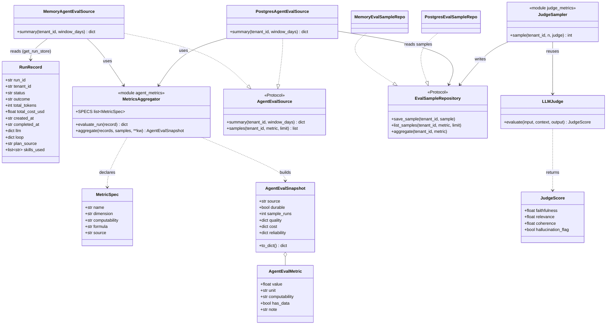
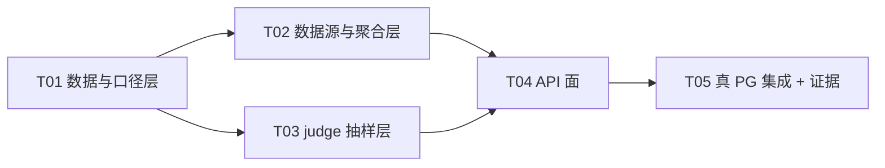

# INC8 · 阶段B — Agent Evaluation System 架构设计

> 角色：架构师（高见远）｜ 类型：**只读设计**（本轮不改任何源码，唯一产出即本文档）
> 事实源：`目标.md` §5「P1-六」、§6「缺口登记」、§8「环境约束」、§10「交付纪律」
> 依赖源码：`forgeflow/evaluation/*`、`forgeflow/api/routers/metrics.py`、`forgeflow/observability/{metrics_source,slo,context_stats,metrics_store}.py`、`forgeflow/cost/{ledger,budget_service}.py`、`forgeflow/runtime/{orchestrator,llm_planner}.py`、`forgeflow/validation/loop_breaker.py`、`forgeflow/repositories/*`、`alembic/versions/{001,003,005,011}*.py`、`forgeflow/rbac/policies.py`、`forgeflow/middleware/auth.py`
> **路径选择说明**：本仓库过程文档遵循 `docs/sop/NN-*.md` 编号约定（`01-PRD` … `08-FRAMEWORK-ALIGNMENT`、`10-AGENT-LLM-RUNTIME`）。团队负责人给的候选路径为 `docs/INC8-AGENT-EVALUATION-DESIGN.md`；为遵循既有编号约定，本文实际落盘于
> **`docs/sop/11-INC8-AGENT-EVALUATION-DESIGN.md`**（`NN=11`，因 `09` 已被 `ForgeFlow-main/docs/sop/09-QA-REPORT-INC3.md` 占用、`10` 已被 `10-AGENT-LLM-RUNTIME.md` 占用）。若主理人坚持无编号路径，改名为 `docs/sop/11-*.md` 之外的 `docs/INC8-*.md` 即可，内容不变。

---

## 1. 范围与不做什么

### 1.1 本设计要做什么（一句话）

把「测试通过率」之外的 **12 项 Agent 质量/成本/可靠性指标** 落到既有 PG + 既有 `/metrics/*` 读面上，**每一项诚实标注其可算性**，并为不可算项给出诚实的替代口径或「暂不提供」。

### 1.2 显式不做（**§10.1 禁止事项，逐条对照**）

| 禁止项（§10.1） | 本设计如何规避 |
|---|---|
| ❌ 再增加一个 Agent | 不新增任何 Agent。指标全部是对**既有** run / 治理 / 成本数据的聚合。 |
| ❌ 再增加一个数据库 | 复用既有 PG（容器 `agentflow_postgres` :5433）。 |
| ❌ 再增加一个向量库 | 不引入。Retrieval/Memory 类指标只**读既有** `context_build_stats`，不新建检索组件。 |
| ❌ 再增加一个 RAG 算法 | 不引入。`Retrieval Recall` / `Citation Accuracy` 本设计要求**如实标为 ⛔**（属 P1-五 独立增量），**不造算法**。 |
| ❌ 再增加一个 UI 页面 | **不新增任何前端页面**。指标经既有 `/metrics/*` 面暴露，供既有 Cost/Analytics/Ops 视图或首页 KPI 复用（§6 给出最小复用方式）。 |
| ❌ 再增加一个框架 | 不引入。仅用 FastAPI / asyncpg / pydantic（已在用）。 |
| ❌ 为了「高级」堆技术名词 | 不引入 OTel 新后端、不引入新调度器；judge 复用**既有** `evaluation/judge.py`。 |

### 1.3 关键纪律：**不粉饰**

- 每个指标必须落在 ✅ / 🟡 / ⛔ 三类之一，并写出**精确来源（表.列 或 对象.字段）**与**口径公式**。
- **禁止**用代理指标冒充真指标而不标注；凡标 ⛔ 的，本设计明确写「缺什么 ground truth」+「替代的诚实口径」或「暂不提供」。
- 本设计本身**不跑任何写操作**、不改源码、不做 `git add/commit/stash`。

---

## 2. 12 指标 × 三维映射表（本文核心）

> 可算性图例：✅ = 可由**现有数据**算出 ｜ 🟡 = 需**新增埋点/接线**才能算 ｜ ⛔ = 当前**诚实不可算**（缺 ground truth），给替代诚实口径。
> 「已有消费方」= 现有代码里是否已有人读这个数（用于暴露「有实现、零调用方」）。

| # | 指标 | 维度 | 可算性 | 精确数据来源（表.列 / 对象.字段） | 口径 / 公式 | 已有消费方 |
|---|---|---|---|---|---|---|
| 1 | **Task Success Rate** | Quality | ✅ | 内存档：`RunRecord.status`（`runtime/orchestrator.py`，值 `completed`/`failed`）；PG 档：`workflow_runs.status` | `completed / (completed + failed)`（终态分母）。**口径=运行级完成率（验证裁决 verdict.success），是对「任务成功」的代理，非 ground-truth 成功率**；真值仅存在于 20 例评测集（见 #1 备注） | ✅ `GET /metrics/`（`MemoryMetricsSource.summary().success_rate`）、`/metrics/slo` |
| 2 | **Tool Selection Accuracy** | Quality | ⛔ | 无 ground truth「应选的工具集」。现有仅：`RunRecord.llm.plan.steps[]`（已选工具）、`RunRecord.llm.plan.dropped_tools[]`（模型幻觉出的越权工具）、`RunRecord.errors[]`（含 `rbac_denied`） | **真指标缺 ground truth，暂不提供**。替代诚实口径（✅ 可算）= **Tool Plan Validity Rate** `1 − |dropped_tools| / |planned steps|`；附 **RBAC 通过率** = `1 − (含 rbac_denied 的 run 数 / 有 plan 的 run 数)` | ❌ 无 |
| 3 | **Planning Accuracy** | Quality | ⛔ | 无 ground truth「正确计划」。现有仅：`RunRecord.llm.plan.source`（`llm`/`fallback`）、`RunRecord.llm.reflection.success`（LLM 自评） | **真指标缺 ground truth，暂不提供**。替代诚实口径（🟡）= **真实规划率** `plan.source=='llm' 占比` + **反思自评通过率** `reflection.success is True 占比`（**自评，弱证据，须标注**） | ❌ 无 |
| 4 | **Retrieval Recall** | Quality | ⛔ | 无 ground-truth「相关条目集合」。现有仅：`context_build_stats.hit_rate`（压缩命中率，**非 recall**） | **缺 ground truth，暂不提供**。不得用 `hit_rate` 冒充 recall（口径不同） | ❌ 无 |
| 5 | **Citation Accuracy** | Quality | ⛔ | 平台**未建模**引用/证据（P1-五「RAG→可信知识系统」为 `[ ]`，`目标.md` §6） | **暂不提供**，归属 P1-五 独立增量；本设计不引入答案引用结构 | ❌ 无 |
| 6 | **Groundedness** | Quality | 🟡 | 机器已存在：`evaluation/judge.py::JudgeScore.faithfulness`（0–1）。**但**：(a) judge 硬绑 `ChatOpenAI`（离线档不可用）；(b) judge 只挂在批量 `EvalRunner`，**未接入运行时**；(c) 评分**未落库**（`run_metrics` 无写入方，见 §7） | 口径 = `avg(faithfulness)`。**需新增**：① judge 路由到**配置的 provider**（Ollama）；② 结果落 `agent_eval_samples`（#012）；③ **离线/抽样/批量**（严禁 run 回环内逐条 LLM） | ⚠️ `GET /metrics/evaluation` 读 `run_metrics` 但**无生产者** → 实际恒 `sample_count=0`（死读，见 §7） |
| 7 | **Hallucination Rate** | Quality | 🟡 | 同 #6 的 `JudgeScore.hallucination_flag`；**另有确定性代理**：`RunRecord.llm.plan.dropped_tools` | 口径 = `flagged / evaluated`。**需新增**同 #6 的接线与落库。**附加 ✅ 可算的确定性代理**：**幻觉工具率** = `dropped_tools 非空的 run / 有 plan 的 run` | ❌ 无 |
| 8 | **Memory Recall** | Quality | ⛔ | 无 ground truth「应召回的 memory」。现有仅：`context_build_stats.{tokens_raw,tokens_used,compression_ratio,hit_rate}`、`ContextBundle.recalled` | **真指标缺 ground truth，暂不提供**。替代诚实口径（✅ 运行信号）= `context_build_stats` 的 `recalled` / `sections` 计数（**运营信号，非 recall，须标注**） | ⚠️ `GET /context`（INC7 新增读面，仅汇总计数） |
| 9 | **Skill Reuse Rate** | Quality | 🟡 | 平台级：`skills.usage_count`（`registry.py:129` 命中即 `+1`，`postgres/skill_repo.py` 落库）、`skills.last_used_at`（011 加列）。**逐任务**：`ctx.available_skills`（`orchestrator._build_run_context`）**未随 run 持久化** | 逐任务口径 = `使用了 ≥1 个复用技能的 run / 全部 run`。**需新增**：把 `available_skills` 落到 `RunRecord`（内存档）或 `context_build_stats.skill_refs`（PG 档）。**平台级代理 ✅ 可算**：`usage_count>0 的技能占比`（非逐任务率，须标注） | ❌ 无（`usage_count` 仅用于排序/进化建议） |
| 10 | **Cost per Task** | Cost | ✅ | 内存档：`RunRecord.{total_cost_usd,total_tokens}`（A1 生产者，`orchestrator._record_usage`）；PG 档：`workflow_runs.total_cost_usd`；账本 `cost/ledger.py` | `avg(total_cost_usd)` per run（及 `total_cost_usd / total_tokens`）。**免费档（mock/Ollama）诚实为 0，非伪造** | ✅ `/metrics/`（`avg_cost_usd`）、`/cost/*`、首页 KPI#3 `/cost/savings` |
| 11 | **Latency p50 · p95** | Reliability | ✅ | 内存档：`RunRecord.{created_at,completed_at}`（ISO-8601 UTC）；PG 档：`workflow_runs.{created_at,completed_at}` | `duration_ms = completed_at − created_at`；`p50`/`p95` = 该样本的分位数。**现有 `/metrics/` 只给均值、`/metrics/slo` 用均值冒充 p95**（`slo.py` 自述）→ 本设计直接算真分位数 | ✅ `/metrics/`（`avg_latency_ms`，均值）、`/metrics/slo`（p95≈均值） |
| 12 | **Failure Recovery Rate** | Reliability | ✅ | `RunRecord.loop.observations`（`LoopBreaker.to_dict()`，>0 即「首次裁决失败、进入重规划回环」）＋ `RunRecord.status` | `#{observations>0 且 status=='completed'} / #{observations>0}`。**「需要重规划」= `observations>0`**（默认预算下 2 次重试 → observations=2；首跑成功 → 0） | ❌ 无（`loop` 经 `GET /runs/{id}` 透出，但无聚合消费方） |

### 2.1 可算性汇总（主理人要求）

| 可算性 | 数量 | 指标 |
|---|---|---|
| ✅ 可由现有数据算出 | **4** | #1 Task Success Rate、#10 Cost per Task、#11 Latency p50·p95、#12 Failure Recovery Rate |
| 🟡 需新增埋点才能算 | **3** | #6 Groundedness、#7 Hallucination Rate、#9 Skill Reuse Rate |
| ⛔ 当前诚实不可算 | **5** | #2 Tool Selection Accuracy、#3 Planning Accuracy、#4 Retrieval Recall、#5 Citation Accuracy、#8 Memory Recall |

**⛔ 五项的原因（缺什么 ground truth / 为何不可算）：**

1. **Tool Selection Accuracy** — 缺「每个任务应选哪（几）个工具」的**标注真值**。平台只记录「模型实际选了哪些、幻觉掉了哪些」，没有「正确答案」可比。
2. **Planning Accuracy** — 缺「正确计划」的真值。LLM 只能**自评**（`reflection.success`），自评 ≠ 正确性。
3. **Retrieval Recall** — 缺「相关条目全集」。`context_build_stats.hit_rate` 是**压缩命中率**，与 recall 口径不同，**不得冒充**。
4. **Citation Accuracy** — 平台**未建模**引用/证据，属 P1-五（`目标.md` §6 明确 `[ ]`）；本轮不新增 RAG 算法（§10.1）。
5. **Memory Recall** — 缺「应召回的 memory 真值」；`context_build_stats` 只有计数，无相关性标注。

> **诚实底线**：以上 5 项在 API 响应里 `computable="not_available"`、`value=null`，**绝不落 0**，并在 `note` 写明原因。

---

## 3. 数据模型

### 3.1 复用既有表 / 对象（**不新建数据库**）

| 复用对象 | 供哪些指标 | 备注（诚实边界） |
|---|---|---|
| `RunRecord`（内存，`runtime/orchestrator.py`） | #1 #2 #3 #7 #9 #10 #11 #12 | **Hub run 仅存内存**（§6 评审⑪ 高）。指标因此是**进程生命周期内**的。 |
| `workflow_runs`（PG，migration `001`） | #1 #10 #11（**legacy workflow 路径**） | Hub run **从不写它** → PG 档下 hub 活动对其贡献为 0（同一评审⑪ 行）。 |
| `run_metrics`（PG，migration `003`+`005`） | （**不采用为源**） | **无任何写入方**（全仓 grep `write_metric`/`record_run_completion` 仅命中定义处）→ `/metrics/evaluation` 恒 `sample_count=0`。**本设计明确不复用它的读面作为 groundedness/hallucination 来源**（避免放大死读）。 |
| `context_build_stats`（PG，migration `011`） | #8（运营代理）、#9（PG 档 skill 复用） | 仅 PG 档写入（`persist_context_build` 在 memory 档 return False）。 |
| `skills`（`usage_count`/`last_used_at`，011） | #9（平台级代理） | `usage_count` 命中即 +1（`registry.py:129`）。 |

### 3.2 是否需 `012` 新迁移？—— **需要，且仅 1 张表 + 1 个加列**

**裁决理由**：12 项里 4 项 ✅ 可从既有字段算出（**无需迁移**）；3 项 🟡 中的 **Groundedness / Hallucination Rate 属「全新数据」**（judge 评分），若不落库就重复了「hub run 不持久化」的老坑；因此给**唯一一张**表 `agent_eval_samples`。迁移遵守 **只增不破**（全部 `IF NOT EXISTS`；**不触碰 010 及更早**）。

> ⚠️ **FK 陷阱（必须避开）**：`run_metrics.run_id` 有 `REFERENCES workflow_runs(id)`。Hub run 不在 `workflow_runs` → 若把 judge 分写进 `run_metrics` 会在 PG 档 **FK 违约**。故新表 `run_id` **用 `TEXT`、不建 FK**。

**`alembic/versions/012_agent_eval_samples.py` DDL 草案：**

```sql
-- 新表：judge 抽样评分 +（可选）确定性代理分，统一承载「既有表算不出」的指标
CREATE TABLE IF NOT EXISTS agent_eval_samples (
    id           UUID PRIMARY KEY DEFAULT gen_random_uuid(),
    tenant_id    UUID,                      -- 与 _as_uuid 语义一致：非 UUID（"default"）→ NULL
    run_id       TEXT,                      -- hub run id（RunRecord.run_id）；**故意不加 FK**（hub run 不在 workflow_runs）
    metric_name  VARCHAR(64)  NOT NULL,     -- groundedness | hallucination | tool_validity | ...
    metric_value DOUBLE PRECISION NOT NULL, -- 归一化 0..1
    metric_unit  VARCHAR(32),
    dimension    VARCHAR(16)  NOT NULL,     -- quality | cost | reliability
    source       VARCHAR(32)  NOT NULL DEFAULT 'judge',  -- judge | deterministic
    dataset      VARCHAR(128),              -- 批量评测时的 dataset id（如 sales_ops-eval-20）
    meta         JSONB NOT NULL DEFAULT '{}',
    created_at   TIMESTAMPTZ NOT NULL DEFAULT now()
);
CREATE INDEX IF NOT EXISTS idx_agent_eval_samples_tenant_time
    ON agent_eval_samples (tenant_id, created_at DESC);
CREATE INDEX IF NOT EXISTS idx_agent_eval_samples_run
    ON agent_eval_samples (run_id);
CREATE INDEX IF NOT EXISTS idx_agent_eval_samples_metric
    ON agent_eval_samples (metric_name, created_at DESC);

-- 加列（只增）：让 PG 档也能算「逐任务 skill 复用」（指标 #9）
ALTER TABLE context_build_stats
    ADD COLUMN IF NOT EXISTS skill_refs TEXT[] NOT NULL DEFAULT '{}';
```

**downgrade（严格镜像，仅回收本迁移新增物）：**

```sql
ALTER TABLE context_build_stats DROP COLUMN IF EXISTS skill_refs;
DROP TABLE IF EXISTS agent_eval_samples;
```

### 3.3 内存档的加性字段（**零迁移**，低风险，须标注为「改 orchestrator」）

`RunRecord` 是纯内存对象，为算 #3/#9 需 2 个**加性字段**（默认值保证老记录与全部构造点不破）：

```python
# forgeflow/runtime/orchestrator.py — RunRecord（加性，默认安全）
plan_source: str = "fallback"          # 复用 task.context["llm_runtime"]["plan"]["source"]
skills_used: list[str] = field(default_factory=list)   # = ctx.available_skills（run_task 构造时填入）
```

> ⚠️ 这 2 个字段是**唯一**需要碰 `orchestrator.py` 的改动（各 1 行赋值 + 字段声明），且不改变任何既有行为（默认值使老路径零变化）。**若主理人判定「本轮不碰 orchestrator」**，则 #3/#9 降级为「仅从 `RunRecord.llm.plan.source` 与 `context_build_stats` 聚合」，逐任务 skill 复用暂缺——见 §10 开放问题 O3。

---

## 4. 模块与文件清单（新增 / 修改 + 依赖方向）

> 约定：**新文件放进既有包**，沿用既有命名与分层；**禁止循环依赖**。
> 依赖方向（单向）：`api/routers` → `evaluation/*` → `observability/metrics_source`（既有）→ `runtime/orchestrator`（既有）；`evaluation/*` → `repositories/*` → `models/*`。**反向禁止**（`evaluation` 不得 import `api`）。

### 4.1 新增文件

| # | 相对路径 | 职责 | 依赖（单向） |
|---|---|---|---|
| N1 | `forgeflow/evaluation/agent_metrics.py` | 12 指标的**纯定义与纯函数**：`MetricSpec`（name/dimension/computability/formula/source）、`evaluate_run(record)->dict`、`aggregate(records, **kw)->AgentEvalSnapshot`。**无 I/O、import 安全**（不 import router/orchestrator 顶层）。 | 标准库；`evaluation.metrics`（既有 `RunMetrics`/`EvalSummary` 可借用分位逻辑） |
| N2 | `forgeflow/evaluation/eval_source.py` | `AgentEvalSource` Protocol + `MemoryAgentEvalSource`（聚合 `get_run_store()`）+ `PostgresAgentEvalSource`（聚合 `agent_eval_samples` + `workflow_runs`）。**镜像既有 `observability/metrics_source.py` 的双后端模式**（`get_agent_eval_source()`/`reset_agent_eval_source()`）。诚实标志 `has_data`/`durable`/`source` 一并返回。 | N1；`observability.metrics_source`（复用分位/时长助手思路）；**延迟 import** asyncpg/orchestrator（保持离线档 stdlib-only） |
| N3 | `forgeflow/evaluation/judge_metrics.py` | **离线/抽样**的 judge 评分：复用既有 `evaluation/judge.py`，但把模型从硬编码 `ChatOpenAI` **可注入**（配置 provider），批量 ≤N、**结果缓存**、写 `agent_eval_samples`。**严禁 run 回环内逐条调用**。 | N1；`evaluation.judge`（既有）；`repositories`（N4） |
| N4 | `forgeflow/repositories/eval_sample_repo.py` | `EvalSampleRepository` Protocol（`save_sample`/`list_samples`/`aggregate`）+ `MemoryEvalSampleRepo`；PG 实现在 `repositories/postgres/`（本设计给接口，实现随 `012`）。`tenant_id` 为第一参数（house rule）。 | `repositories.base`（`new_id`/`utcnow`） |
| N5 | `alembic/versions/012_agent_eval_samples.py` | §3.2 的 DDL（只增不破，downgrade 镜像）。 | alembic |

### 4.2 修改文件（**最小 diff，不碰冻结哈希清单**）

| # | 相对路径 | 改动 | 风险 |
|---|---|---|---|
| M1 | `forgeflow/api/routers/metrics.py` | **新增** `GET /agent-eval`（+ 可选 `GET /agent-eval/samples`）。复用既有 `_optional_pool`/`_is_offline` 双后端契约。 | 低（既有 router 未冻结） |
| M2 | `forgeflow/api/schemas.py` | 新增 `AgentEvalSummaryResponse` / `AgentEvalDimension` / `AgentEvalMetric`（**纯加性**，不动既有 schema，约束 C3 精神）。 | 低 |
| M3 | `forgeflow/runtime/orchestrator.py` | §3.3 的 **2 个加性字段**（默认安全）。（可选，见 §10-O3） | 中（牵动运行时；默认值保证零行为变化） |
| M4 | `forgeflow/observability/context_stats.py` | 可选：`record_context_build` 增记 `skill_refs`（配合 §3.2 加列）。 | 低 |
| — | **不改** `forgeflow/rbac/policies.py` | 新面嵌在 `/metrics/*` 下，被既有 `("GET","/metrics")→("read","metrics")` **最长前缀覆盖**（`middleware/auth.py:136-144` 实测 `path.startswith` 语义）→ **无需新增 map 条目**（§6 详述）。 | — |

### 4.3 类图（Mermaid classDiagram）



---

## 5. 计算时机裁决：**读时按需聚合** + **judge 离线抽样**

| 指标组 | 裁决 | 理由 |
|---|---|---|
| **运行派生类**（#1 #2(代理) #3(代理) #7(代理) #10 #11 #12） | **读时按需聚合**（`AgentEvalSource.summary()` 现算） | ① 与既有 `/metrics/*` 一致（`MetricsSource` 本就读时聚合）；② 只需读**既有字段**，O(n)（run store 很小）；③ **不改 run 回环**、**不动 orchestrator 写路径** → 风险最低。 |
| **judge 类**（#6 #7 真值） | **离线/抽样/批量**（`JudgeSampler.sample()`，显式触发，非 run 内） | **LLM 延迟硬约束**：`qwen3:8b` ≈18.6s/次（`目标.md` §8）→ **严禁循环内逐条 LLM**。批量 ≤N、结果**缓存**、写 `agent_eval_samples`，读时只聚合落库样本。 |

**明确否决的方案**：❌「run 结束时增量逐条算全部 12 项」——会把 judge 塞进运行时热点、放大延迟与成本，且 hub run 不落库使增量写也无处持久化。

---

## 6. API 面

**优先扩展既有 `/metrics/*`**（避免新开路径、避免新增 RBAC 条目）。

### 6.1 新增端点

| method | path | 说明 | RBAC |
|---|---|---|---|
| `GET` | `/metrics/agent-eval` | 12 指标 × 三维汇总（质量/成本/可靠性）+ 每指标可算性 | 被 `("GET","/metrics")` 覆盖 → `(read, metrics)` |
| `GET` | `/metrics/agent-eval/samples` | 可选：按 metric 下钻样本（从 `agent_eval_samples` / 内存缓冲） | 同上 |

**RBAC 结论（fail-closed 校验）**：`middleware/auth.py::_resolve_permission` 用 `path.startswith(prefix)` 最长前缀匹配；既有 `/metrics/evaluation`、`/metrics/slo`、`/metrics/runs` 均由唯一 `("GET","/metrics")` 覆盖，故 `/metrics/agent-eval` **天然被覆盖，无需改 `ROUTE_PERMISSION_MAP`**。
> ✅ 不新增路由条目 → 不触碰 `ROLE_PERMISSIONS`、不放宽任何权限、也无「幻影路由」风险。
> ⚠️ 工程师须用既有 `tests/unit/test_fact_source_alignment.py`（UNMAPPED=0）复核：新增 path 必须落进既有前缀。

### 6.2 响应 schema 草案（`api/schemas.py`，纯加性）

```python
class AgentEvalMetric(BaseModel):
    value: float | None = None       # ⛔ 时恒 None，绝不 0
    unit: str = ""
    computability: str = "ok"        # ok | needs_instrumentation | not_available
    has_data: bool = False
    formula: str = ""
    source: str = ""
    note: str = ""                   # 诚实口径 / 缺什么 ground truth

class AgentEvalDimension(BaseModel):
    metrics: dict[str, AgentEvalMetric] = {}

class AgentEvalSummaryResponse(BaseModel):
    source: str = "hub_runs"         # hub_runs | postgres
    durable: bool = False            # 读内存 run store 时 False（依赖 §6 评审⑪）
    window_days: int = 30
    sample_runs: int = 0
    judged_samples: int = 0          # agent_eval_samples 命中数（groundedness/hallucination 数据基础）
    quality: AgentEvalDimension = AgentEvalDimension()
    cost: AgentEvalDimension = AgentEvalDimension()
    reliability: AgentEvalDimension = AgentEvalDimension()
    generated_at: str = ""
```

**示例（诚实呈现）**：

```json
{
  "source": "hub_runs", "durable": false, "window_days": 30,
  "sample_runs": 12, "judged_samples": 0,
  "quality": { "metrics": {
      "task_success_rate": {"value": 0.833, "computability": "ok", "has_data": true,
        "formula": "completed/(completed+failed)", "source": "RunRecord.status",
        "note": "运行级完成率（验证裁决），对『任务成功』的代理"},
      "tool_selection_accuracy": {"value": null, "computability": "not_available",
        "has_data": false, "note": "缺『应选工具集』ground truth；替代：tool_plan_validity_rate"},
      "groundedness": {"value": null, "computability": "needs_instrumentation",
        "has_data": false, "note": "judge 未接线/未落库，judged_samples=0"},
      "hallucination_rate": {"value": 0.0, "computability": "needs_instrumentation",
        "has_data": false, "note": "judge 未接线；确定性代理见 hallucinated_tool_rate"}
  }},
  "cost": { "metrics": {
      "cost_per_task": {"value": 0.0, "computability": "ok", "has_data": true,
        "formula": "avg(total_cost_usd)", "source": "RunRecord.total_cost_usd",
        "note": "免费档(mock/Ollama)诚实为 0"}
  }},
  "reliability": { "metrics": {
      "latency_p50_ms": {"value": 812.0, "computability": "ok", "has_data": true},
      "latency_p95_ms": {"value": 2103.0, "computability": "ok", "has_data": true},
      "failure_recovery_rate": {"value": 0.5, "computability": "ok", "has_data": true,
        "formula": "#{obs>0 & completed}/#{obs>0}", "source": "RunRecord.loop.observations"}
  }}
}
```

### 6.3 UI 复用（**不新增页面**，§10.1）

最小方式（三选一，均**不加页面**）：
1. 既有 **CostView / OverviewView / Analytics** 视图读 `/metrics/*`：在既有 KPI 卡片流里**追加**若干只读卡片（复用 `useHomeKpis()` 同款 hook 模式），**不新建路由/视图组件**。
2. 若不想动前端：仅暴露 API + `docs/api-reference.md` 表格（**零前端改动**），由既有 `/metrics/prometheus` 亦可挂 2–3 个 gauge。
3. 可选：`/metrics/prometheus` 增 3 个 gauge（success_rate/p95/cost_per_task）→ 复用既有注册表，**不新增框架**。

> 本设计**默认采用方式 2**（零前端改动，最稳），前端呈现留给后续独立增量。

---

## 7. 与既有缺口的交叉（**依赖 / 放大**，逐条点名）

| 既有缺口（`目标.md` §6） | 本设计关系 | 诚实呈现方式 |
|---|---|---|
| **评审⑪ 高 — Hub run 无 PG 持久化**（`MemoryRunStore` 唯一实现，`get_run_store()` 不看 `STORAGE_BACKEND`） | **强依赖**：#1 #10 #11 #12 全部读 `RunRecord` → 这些指标是**进程生命周期内**的；进程重启即归零。**PG 档下 hub 活动对 `/metrics/*` 的 `workflow_runs` 分支贡献恒为 0。** | 响应带 `source="hub_runs"` + `durable=false`；**绝不**把「进程内数字」当作持久化指标呈现。**若 hub run 不落库，则：**#1（成功率）、#10（成本）、#11（延迟）、#12（恢复率）在**重启后天然为「无数据」**（非 0）→ API 返回 `has_data=false` + `value=null`。 |
| **评审⑪ 中 —「run」语义二分**（`workflow_runs` vs hub `RunRecord` 同名不同物） | **放大风险**：若把两源混算会得到假数字。 | `AgentEvalSource`：**内存档只读 hub run store**；PG 档只读 `workflow_runs`+`agent_eval_samples`；**绝不混合**，并在 `note` 标 `source`。 |
| **评审⑪ 中 — `GET /metrics/evaluation` PG 档 fail-open 吞异常** → 全零摘要 | **放大风险**：若复用该读面做 groundedness，会把「查询坏」当「真无数据」。 | **不复用** `run_metrics` 读面作为评分来源；本设计走 `agent_eval_samples`。 |
| **`run_metrics` 结构性死读（本轮实测，详见 §12.3）** | **不采用为源**：本方案**不复用也不依赖** `run_metrics` / `/metrics/evaluation`。 | 该读面诚实化处置属**阶段A**（工程师 A1/A7），**不纳入本设计实施任务**。 |
| **评审⑨ 低 — `workflow_runs` 无 `tenant_id`** → PG 档聚合是平台级 | 影响 PG 档 #1/#10/#11 的**租户切分**。 | PG 档 `note` 标注「平台级（无 tenant 列）」；内存档按 `tenant_id` 过滤（`get_run_store().list` 支持）。 |
| **工程 中低 — `context_build_stats` 只写不读** | INC7 已补 `read_build_stats_pg`+`/context`；本设计 #8 复用该读面。 | #8 标 `not_available` + 附「运营信号」替代；memory 档无该表数据 → `has_data=false`。 |
| **P1-五 RAG 可信知识系统未建** | **强依赖**：#4 Retrieval Recall / #5 Citation Accuracy **不可算**。 | 两项标 ⛔ + `note` 指向 P1-五，**明确「暂不提供」**。 |
| **P0-2 `LLM_PROVIDER=mock` 跑不了真实图**（结构化输出退化 `{}`） | 影响 #3 真实规划率（mock 档恒 `fallback`）。 | #3 代理值在 mock 档天然偏低 → `note` 标「mock 档 plan.source 恒 fallback，非质量下降」。 |

**`run_metrics` 死读的实测证据（交叉登记）：**
- `forgeflow/observability/metrics_store.py:16 write_metric` / `:41 record_run_completion` 是唯一写入口，但**全仓零调用方**（含 `tests/`——`tests/unit/test_metrics_store.py` 只调用 `get_cost_by_workflow_type`/`get_top_expensive_runs`/`get_budget_alerts` 等**读**方法）；`scripts/run_eval.py` 只把结果写 JSON/stdout。
- `GET /metrics/evaluation`（`api/routers/metrics.py:175`）恒 `sample_count=0`；`dashboard/pages/4_evaluation.py:59` 仍硬编码宣称 `"Scores are computed by GPT-4o-mini acting as judge."`（**看板声明与数据现状不符**）。
- `metrics_store.py:38-39` 用 `except Exception: logger.error` **静默吞掉**写入失败 → 「接了线也永远不知道坏了」。

> **不粉饰底线**：以上所有「依赖既有未解缺口」的指标，**不得**为了让看板好看而放宽口径或填 0。

---

## 8. 测试方案

| 层 | 测什么 | 位置 |
|---|---|---|
| **单元（内存）** | `agent_metrics.evaluate_run/aggregate` 逐指标：给定构造的 `RunRecord` 列表 → 断言 #1/#10/#11/#12 精确值；空 store → #1/#10/#11/#12 `value=null`、`has_data=false`（**非 0**）；#2/#3/#4/#5/#8 `computability="not_available"`；#6/#7/#9 `needs_instrumentation`。 | `tests/unit/test_agent_eval_metrics.py` |
| **单元（非空转证明）** | **内存注入 → 必红**：向 run store 注入 1 条 `status="failed"` 记录 → `task_success_rate` **必变化**；把 `loop.observations=0` 全置 0 → `failure_recovery_rate` **必为 null（has_data=false）**；把某 ⛔ 指标硬编码成数字 → 断言 `computability` **必失败**。 | 同上（自写注入插件，独立于实现） |
| **单元（API）** | ASGI `GET /metrics/agent-eval`：memory 档 200 + schema 字段齐全；断言 ⛔ 项 `value is None`。 | `tests/unit/test_agent_eval_api.py` |
| **集成（真 PG 5433）** | `012`：`alembic upgrade head` **连跑两次幂等**（版本→`012`）；`agent_eval_samples` 写→读回；`context_build_stats.skill_refs` 加列后可写读；**tenant `"default"→NULL` 的 `_as_uuid` 陷阱**（过滤须用 `IS NULL`）。 | `tests/integration/test_agent_eval_pg.py` |
| **集成（RBAC）** | 真 uvicorn：viewer(有 `read:metrics`) → 200；无 token → 401；`UNMAPPED=0` 复核（`test_fact_source_alignment`）。 | 复用既有 `test_fact_source_alignment.py` 思路 |
| **judge（离线可跑）** | mock judge（`judge` 注入替身）验证抽样/缓存/落库路径；**不发真实 LLM**。真 Ollama judge 仅作手工证据。 | `tests/unit/test_judge_metrics.py` |

**「新测试非空转」证明方式（对齐本仓库既有做法）**：QA 自写注射插件（3 处注入：篡改 1 个 ✅ 指标、置空 ⛔ 口径、删 `012`）→ 对应测试**必红**；复原 → 绿。

---

## 9. 风险、回滚与不做完的部分（如实）

| 项 | 说明 |
|---|---|
| **风险 R1：hub run 不落库** | #1/#10/#11/#12 为进程内、重启归零。**缓解**：`durable=false` 显式暴露；本轮**不改** hub run 落库（属 §10.1 外的新行为，见 §10-O2）。 |
| **风险 R2：judge 延迟/成本** | 真 Ollama judge ≈18.6s/次。**缓解**：离线抽样 + 批量 + 缓存；**绝不进 run 回环**。离线档默认 **不跑** judge（`judged_samples=0`）。 |
| **风险 R3：改 orchestrator** | M3 是唯一碰运行时的改动，虽默认安全仍有回归面。**缓解**：加性字段 + 默认值 + 定向回归（`test_graph.py`/`test_runs_api.py`）。可选降级（§10-O3）。 |
| **风险 R4：`012` 迁移** | 只增不破；`run_id` 不建 FK（避开 `run_metrics` 的 FK 陷阱）。**回滚**：§3.2 的镜像 downgrade。 |
| **风险 R5：PG 档租户切分** | `workflow_runs` 无 `tenant_id` → PG 档为平台级。**缓解**：`note` 标注。 |
| **回滚方案** | ① 迁移：`alembic downgrade 011`（镜像）；② 路由：`main.py` 撤 include（或回退 M1/M2）；③ M3：字段带默认值，保留亦无副作用。 |
| **本轮明确「不做完」** | ① 5 项 ⛔ **暂不提供**（P1-五 / 缺 ground truth）；② hub run 落库**不纳入本轮**；③ 逐任务 Skill Reuse（若 O3 判定不碰 orchestrator 则**暂缺**）；④ 前端呈现**不做**（仅 API）。 |

---

## 10. 实施顺序（有序任务 + 依赖，供工程师按序实现）

> 满足「≤5 个大任务、每组 ≥3 文件、基础设施优先、无长线性链」的编排约束。

| 任务 | 名称 | 交付文件 | 依赖 | 优先级 |
|---|---|---|---|---|
| **T01** | **数据与口径层**（迁移 + 仓储 + 纯指标函数 + 单测） | `alembic/versions/012_agent_eval_samples.py`、`forgeflow/repositories/eval_sample_repo.py`（+`repositories/postgres/`实现）、`forgeflow/evaluation/agent_metrics.py`、`tests/unit/test_agent_eval_metrics.py` | — | P0 |
| **T02** | **数据源与聚合层**（双后端 source + 可选 RunRecord 加性字段） | `forgeflow/evaluation/eval_source.py`、`forgeflow/runtime/orchestrator.py`（M3，加性）、`forgeflow/observability/context_stats.py`（M4，可选）、`tests/unit/test_agent_eval_source.py` | T01 | P0 |
| **T03** | **judge 抽样层**（离线/批量/缓存/落库，不阻塞 run） | `forgeflow/evaluation/judge_metrics.py`、`tests/unit/test_judge_metrics.py` | T01 | P1 |
| **T04** | **API 面**（扩展 `/metrics/*` + schema + RBAC 复核） | `forgeflow/api/routers/metrics.py`（M1）、`forgeflow/api/schemas.py`（M2）、`tests/unit/test_agent_eval_api.py` | T02、T03 | P0 |
| **T05** | **真 PG 集成 + 证据**（012 幂等、写读回、双档、非空转） | `tests/integration/test_agent_eval_pg.py`、证据产物（junit/alembic 输出） | T04 | P0 |



**依赖方向核对**：`api/routers` →（T02/T03）→（T01）→ `repositories`；**无循环**。T02 与 T03 并行（均只依赖 T01）。

---

## 11. 需要主理人裁决的开放问题

| # | 开放问题 | 架构师建议 | 影响 |
|---|---|---|---|
| **O1** | 是否允许新增 **`012`** 迁移（1 表 + 1 加列）？ | **建议允许**：judge 评分属「全新数据」，不落库即重复「hub run 不持久化」老坑；只增不破、不碰 010/011。 | 决定 #6/#7 能否持久化 |
| **O2** | 是否允许扩展 **`/metrics/*`**（新增 `/metrics/agent-eval`）？ | **建议允许**：被既有 `("GET","/metrics")` 覆盖，**无需改 RBAC**、无新路由条目。 | 决定 API 面形态 |
| **O3** | **hub run 落库**是否纳入本轮？是否允许动 `orchestrator.py`（M3 加性字段）？ | **建议本轮不落库**（§10.1 外的新行为，且会作废冻结哈希链）；**M3 按「最小加性」允许**，否则 #3/#9 逐任务口径降级。 | 决定 #1/#10/#11/#12 的持久性 与 #3/#9 是否逐任务可算 |
| **O4** | judge 是否为**必交付**（#6/#7 真值）还是**留接口**？ | 建议 **T03 交付「离线抽样接口 + mock 测试」**，真 Ollama judge 仅作手工证据（延迟硬约束）。 | 决定 #6/#7 是否本轮出真值 |

---

## 12. 主理人裁决与实测依据（O1–O4 裁决 + 独立核实）

> 本节由主理人**独立核实源码**后裁决（非采信设计结论），架构师据此登记。**裁决全部批准**，设计无需推翻，仅按下列证据固化 + 落实硬要求。
> 说明：原「开放问题」已为 §11，故本节编号 **§12**，原「结论」顺延为 **§13**。

### 12.1 裁决结论

| 问题 | 裁决 | 依据（实测 file:line） |
|---|---|---|
| **O1** 新增 `012` 迁移 | ✅ **允许** | 见 §12.2（新表 + `run_id TEXT` 不建 FK 的理由成立） |
| **O2** 新增 `GET /metrics/agent-eval` | ✅ **允许** | `forgeflow/rbac/policies.py:110` 已有 `("GET","/metrics"): ("read","metrics")`，最长前缀已覆盖 → **不改 `ROUTE_PERMISSION_MAP`、不动 `ROLE_PERMISSIONS`、不产生幻影项** |
| **O3** hub run 落库 | ✅ **本轮不做**（属 §10.1 外新行为、会作废证据链）。**硬要求**：响应必须显式带 `source="hub_runs"` + `durable=false`，把「重启归零」**暴露而非隐藏**；#9 若降级为平台级代理**必须在指标表如实标注**。`RunRecord` 加性字段 `plan_source`/`skills_used`（安全默认值）✅ 允许 | §7；§3.3；§6.2 已有 `source`/`durable` 字段 |
| **O4** judge 交付范围 | ✅ **只交付「离线抽样接口 + mock 测试」**；真 Ollama judge 仅作手工证据，**禁止**置于 run 回环内（`qwen3:8b`≈18.6s/次 硬约束） | §5；§9-R2 |

### 12.2 「`run_metrics` 不能复用」的实测证据（O1 支撑，架构师复核）

1. `alembic/versions/003_audit_rbac.py:118` —— `run_id UUID NOT NULL REFERENCES workflow_runs(id) ON DELETE CASCADE`：`run_metrics` **强制**外键引用 `workflow_runs`，且列类型为 **UUID**。
2. ⇒ 「把评测结果写进 `run_metrics`」是**死路**：hub run 不在 `workflow_runs`（§6「评审⑪ 高」）；且 `evaluation/runner.py:76` 传的 `run_id=example.id`（形如 `"e01"`）**根本不是 UUID** → 一旦接线必然静默失败。
3. 结论：`012` 新表 `agent_eval_samples`（`run_id TEXT` 不建 FK）裁决成立；**不得**改回复用 `run_metrics`。

### 12.3 `run_metrics` / `GET /metrics/evaluation` 结构性死读（交叉登记，**非**本方案实施任务）

- `forgeflow/observability/metrics_store.py:16 write_metric` / `:41 record_run_completion` 是**唯一写入口**，但**全仓零调用方**（含 `tests/`；`tests/unit/test_metrics_store.py` 仅调用 `get_cost_by_workflow_type`/`get_top_expensive_runs`/`get_budget_alerts` 等**读**方法）。`scripts/run_eval.py` 只把结果写 JSON/stdout，**从不落库**。
- ⇒ `GET /metrics/evaluation`（`api/routers/metrics.py:175`）是**结构性死读**，恒 `sample_count=0`；而 `dashboard/pages/4_evaluation.py:59` 仍硬编码宣称 `"Scores are computed by GPT-4o-mini acting as judge."`（**看板声明与数据现状不符**）。
- `metrics_store.py:38-39` 用 `except Exception: logger.error` **静默吞掉**写入失败 —— 叠加上述 FK/UUID 约束，构成「接了线也永远不知道它是坏的」陷阱。
- **明确边界**：本方案**不复用也不依赖** `run_metrics` / `/metrics/evaluation`；该读面的诚实化处置属**阶段A**（工程师 A1/A7），**不纳入本设计实施任务**。

### 12.4 实施任务是否需据此调整

**无变化。** T01–T05 维持原样；工程师实现时须落实 12.1 的**硬要求**：① 响应带 `source`+`durable`；② #9 降级口径如实标注；③ judge 不进 run 回环；④ 不复用 `run_metrics`。

---

## 13. 结论（一句话）

**12 项指标中，4 项（Task Success / Cost per Task / Latency p50·p95 / Failure Recovery）本轮即可从既有 run 数据诚实算出；3 项（Groundedness / Hallucination / Skill Reuse）需补「judge 接线 + `012` 落库」的埋点；5 项（Tool Selection / Planning / Retrieval Recall / Citation / Memory Recall）因**缺 ground truth 或属 P1-五 未建**，**诚实标为暂不提供**，绝不造数。** 全部经既有 `/metrics/*` 暴露，**不新增前端页面、不新增 Agent/库/框架**，落盘唯一产物即本文档。
