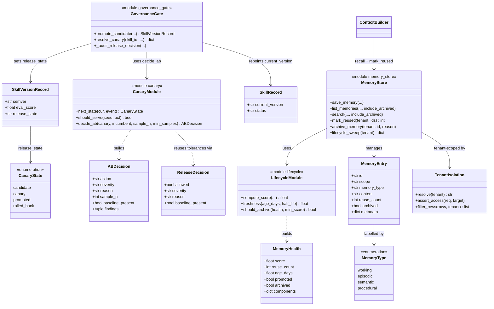
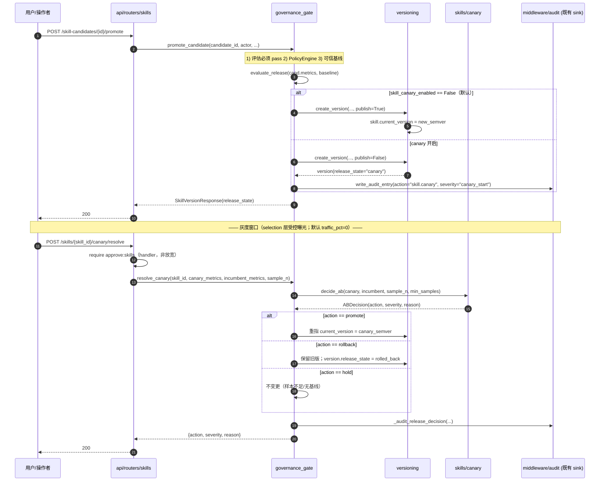
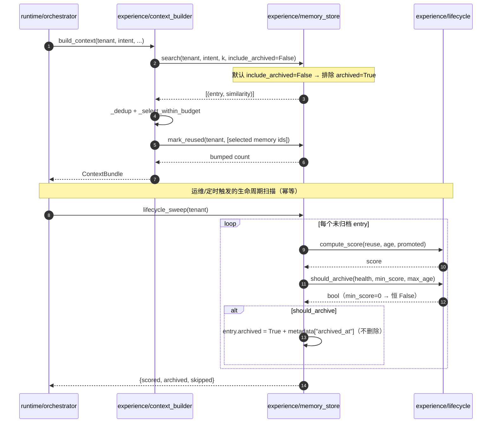
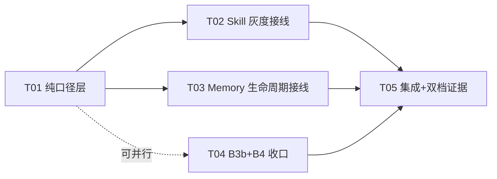

# INC9 · 阶段 §6 剩余缺口补批 — 增量架构设计

> 角色：架构师（高见远 / Gao）｜ 类型：**只读设计**（本轮不改任何源码，唯一产出即本文档）
> 事实源：`目标.md` §4（11 点机制化对照）、§5（优先级队列）、§6（缺口登记，**唯一列表**）、§8（环境约束）、§10（交付纪律）
> 参照文风：`docs/sop/11-INC8-AGENT-EVALUATION-DESIGN.md`（INC8 阶段B，已落盘待提交）
> 覆盖缺口（逐行对照 §6，**不自行加戏**）：**B1 = P0-3**；**B2 = P1-八**；**B3 = 评审① + 评审⑨**；**B4 = 评审⑪ 高**
> 依赖源码（本轮逐个读过，硬约束）：
> `skills/{versioning,governance_gate,release_gate,evolution,evaluator,candidate_compiler,registry,trust_baseline,models}.py`、
> `experience/{scopes,memory_store,promotion,context_builder}.py`、
> `governance/{tenancy,policy_engine,models}.py`、
> `runtime/orchestrator.py`、`repositories/{base,factory}.py`、
> `api/routers/{skills,memory,metrics,runs}.py`、`api/{main,hub_schemas}.py`、
> `rbac/policies.py`、`config.py`、`middleware/audit.py`、
> `evaluation/{regression,eval_source}.py`、`alembic/versions/{011,012}*.py`、`tests/{conftest,unit/test_fact_source_alignment}.py`
> **落盘路径说明**：沿用 `docs/sop/NN-*.md` 编号约定（`NN=12`，因 `11` 已被 INC8 占用）。

---

## 1. 范围与显式不做

### 1.1 本设计要做什么（一句话）

在**既有结构上**补齐 §6 仍开着的 4 行缺口 —— **① Skill 灰度 / A-B / Promote-Rollback 闭环**、**② Memory Lifecycle 后三环 Score/Decay/Archive**、**③ Memory 二维模型 + Tenant Isolation 策略显式声明**、**④ Hub run 审计可追溯性收口** —— **零新增子系统、零新增第三方依赖、零迁移（见 §6）**，且**默认配置下现有行为逐字节不变**。

### 1.2 显式不做（**§10.1 禁止事项，逐条对照**）

| 禁止项（§10.1） | 本设计如何规避 |
|---|---|
| ❌ 再增加一个 Agent | 不新增。四项全部是对**既有** Skill / Memory / Run 数据与既有调用链的补环。 |
| ❌ 再增加一个数据库 | 复用既有 PG（容器 `agentflow_postgres` :5433）与既有**进程内** store；**本增量零迁移**（§6）。 |
| ❌ 再增加一个向量库 | 不引入。B2 复用既有 `experience/embedding.embed_text` + `memory_vectors`；不新建检索组件。 |
| ❌ 再增加一个 RAG 算法 | 不引入。B2 的 Score/Decay 是**可解释加权**，不是检索算法，也不改 recall 口径。 |
| ❌ 再增加一个 UI 页面 | **不新增任何前端页面/路由**。所有新面经既有 `/skills`、`/memory` 前缀暴露（§5.3）。 |
| ❌ 再增加一个框架 | 不引入。仅用 stdlib + FastAPI/pydantic（已在用）。 |
| ❌ 为了「高级」堆技术名词 | **不引入"流量网关/服务网格/影子库"**。B1 的"灰度"用**纯函数 + 状态机 + 既有审计 sink**表达，并**显式声明**平台的真实能力边界（§2.1.6）。 |

### 1.3 关键纪律：**不粉饰**

- 每个设计点必须写出**现状 `file:line`**、**缺口**、**接线点**、**诚实边界**、**回滚**。
- 凡"平台做不到 / 只能给代理口径"的，**必须在正文与代码注释里显式写出**（例：B1 无逐请求 serving 分流；B4 hub run 不落库）。
- 本设计**不跑任何写操作**、不改源码、不做 `git add/commit/stash`；不触碰任何已有文件（工作树正被 QA 冻结复验，本文档是**新增未跟踪文件**）。

---

## 2. 四项设计正文

### 2.1 B1（P0-3）Skill 灰度发布 / A-B 对比 / Promote-Rollback 闭环

#### 2.1.1 为什么做

§6 原文：「**Skill 灰度 / A-B 发布未做**——新技能无小流量验证，只能全量切换；`release_gate` 已是其前置」。
现状是一条完整的"从经验到技能"链，但**缺少"新版本先受控曝光、与旧版同口径对比、再 promote 或 rollback"的最后一跳**：`promote_candidate` 一旦放行，就**立即把 `current_version` 指向新版本 = 全量切换**。

#### 2.1.2 现状（`file:line`）

| 环节 | 位置 | 行为 |
|---|---|---|
| 优化建议 | `skills/evolution.py::advise` | 规则为主 + 至多 1 次批量 LLM，产出 `optimize`/`retire` 建议（**只建议，不改技能**） |
| 候选编译 | `skills/candidate_compiler.py::compile_candidate`（:250） | ≥N 条相似经验 → `SkillCandidateRecord`（`status` draft→…） |
| 评估 | `skills/evaluator.py::evaluate_candidate`（:36） | 确定性打分 `metrics{completeness,coverage,tool_diversity,similarity_score,score}`（:57），`_PASS_THRESHOLD=0.6`（:18） |
| 回归门禁 | `skills/release_gate.py::evaluate_release`（:93） | 候选 vs 被取代版本的**同口径**比对 → `ReleaseDecision{allowed,severity∈{no_baseline,ok,warning,regression}}`；沿用 `evaluation/regression.py::check_dict`（:81）+ `RELEASE_TOLERANCES`（:46） |
| 审批 + 固化 | `skills/governance_gate.py::promote_candidate`（:70） | 必须 pass 评估 + PolicyEngine + 可信基线 + 发布门禁；**成功即 `create_version(...)` 并把 `current_version` 指向新 semver** |
| 版本 | `skills/versioning.py::create_version`（:95） | 生成 semver（minor 递增）+ changelog + diff；**`:128` `skill.current_version = new_semver`（全量切换点）** |
| 回滚 | `skills/versioning.py::rollback`（:134） | 把 `current_version` 指回既有版本（**手动**，无自动触发） |

#### 2.1.3 现状缺口

1. **无灰度态**：`create_version` 直接把 `current_version` 指向新版（`:128`）→ 新版**瞬时全量**生效，无 canary 窗口。
2. **无同口径 A/B 决策**：`release_gate` 只在 **promote 时点**用**候选的已记录指标**比对（`evaluate_release`），放行后**再无二次比较**；没有"样本不足则暂缓（hold）"的语义 —— `ReleaseDecision` 只有 `allowed: bool`，非黑即白。
3. **无自动 Rollback**：`rollback` 是**手动**动作，A/B 结论不能自动触发它。
4. 状态值：`skills/models.py::CANDIDATE_STATUSES`（:13）= `draft/evaluating/approved/rejected/insufficient/promoted`，**无 canary**；`SkillVersionRecord`（:41）无"发布态"字段。

#### 2.1.4 设计方案

**核心裁决 = "灰度"在本平台被诚实地建模为「发布状态机 + 同口径 A/B 纯函数 + 受控曝光 + 审计」，而不是伪造一套不存在的 serving 分流。**（原因见 §2.1.6）

**(a) 新增纯函数/状态机模块 `forgeflow/skills/canary.py`**（新文件，无 I/O、import 安全）：

```python
class CanaryState(str, Enum):
    CANDIDATE   = "candidate"     # 已评估通过，尚未发布
    CANARY      = "canary"        # 已发布为「非默认候选版本」，受控曝光中
    PROMOTED    = "promoted"      # 已 promote，成为 current_version
    ROLLED_BACK = "rolled_back"   # A/B 结论回落，保留旧版

# 纯状态迁移表（无时钟、无 I/O）：(state, event) -> state
_CANARY_TRANSITIONS: dict[tuple[CanaryState, str], CanaryState] = {...}

def next_state(current: CanaryState, event: str) -> CanaryState: ...  # 非法迁移 → 抛 CanaryError(fail-closed)

@dataclass(frozen=True)
class ABDecision:
    action: str          # promote | hold | rollback
    severity: str        # no_baseline | ok | warning | regression
    reason: str
    sample_n: int
    baseline_present: bool
    findings: tuple[...] = ()

def decide_ab(
    canary_metrics: dict | None,
    incumbent_metrics: dict | None,
    *,
    sample_n: int,
    min_samples: int,
    tolerances: dict[str, tuple[str, float, float]] = RELEASE_TOLERANCES,
) -> ABDecision: ...
```

**`decide_ab` 的判定表（纯函数、确定性）** —— 复用 `check_dict` 与 **`RELEASE_TOLERANCES`（与门禁同一张容忍表 → 同口径）**：

| 条件 | action | severity | 理由（诚实） |
|---|---|---|---|
| `sample_n < min_samples` | **hold** | `insufficient` | 样本不足，**拒绝在噪声上下结论** |
| 无可比指标（`no_baseline`） | **hold** | `no_baseline` | 没有基线可比 —— **不等于"通过"** |
| `check_dict` 最坏级 = `regression` | **rollback** | `regression` | 新版相对旧版质量回归 → 自动回滚 |
| 最坏级 ∈ {`ok`,`warning`} 且样本足够 | **promote** | 对应级 | 持平/更优 → 提升为默认版本 |

> **与 `release_gate` 的分工**：`release_gate` 是 promote **前**的**准入**（回归即 403，不许进）；`decide_ab` 是 canary **后**的**裁决**（可 `hold` 观望、可自动 `rollback`）。两者共用 `RELEASE_TOLERANCES`/`check_dict`，**同口径**，不制造第二张容忍表。

**(b) 版本发布态（加性字段，默认零变化）** —— `skills/models.py`：

```python
@dataclass
class SkillVersionRecord:
    ...
    #: INC9 B1 — 发布态。默认 "promoted" = 既有版本的语义（一经 create_version 即默认生效）
    #: 故所有存量记录与既有构造点零变化。
    release_state: str = "promoted"   # promoted | canary | rolled_back
```

**(c) `versioning.create_version` 增加 `publish` 开关（默认 True = 零变化）**：

```python
async def create_version(..., publish: bool = True) -> SkillVersionRecord:
    ...
    await repo.add_version(tenant_id, version)
    if publish:                       # 默认 True —— 既有行为逐字节不变
        skill.current_version = new_semver
        skill.updated_at = utcnow()
        await repo.update_skill(skill)
    return version
```

**(d) 接线点 = `governance_gate.promote_candidate` 的"成功出口"**（现行 `:229–240`）：

- 在 `release` 通过、`create_version` 之后、`candidate.status="promoted"` 之前，插入 canary 分支：
  - `settings.skill_canary_enabled == False`（**默认**）→ **完全走既有路径**（`create_version(publish=True)`，`current_version` 即时切换）= 现有行为零变化。
  - `== True` → `create_version(publish=False)` 生成新版本并置 `release_state="canary"`、`current_version` **保持旧版**；经**既有**审计 sink（`middleware/audit.py::write_audit_entry`，`action="skill.canary"`、`resource="skills"`、`resource_id=skill_name`、`metadata.severity ∈ {canary_start}`）写一条。**不引入新审计组件**。

**(e) 新增 `governance_gate.resolve_canary(...)`**（同文件，复用 `_audit_release_decision` 同款 sink）：

```python
async def resolve_canary(
    skill_id: str, *, tenant_id, actor, actor_role,
    canary_metrics: dict | None, incumbent_metrics: dict | None,
    sample_n: int, ...
) -> dict:
    decision = decide_ab(canary_metrics, incumbent_metrics, sample_n=sample_n,
                         min_samples=get_settings().skill_canary_min_samples)
    if decision.action == "promote":   # 重新指向 canary 版本
        skill.current_version = canary_semver; await repo.update_skill(skill)
    elif decision.action == "rollback":  # 保留旧版，标记 canary 版本 rolled_back
        version.release_state = "rolled_back"; await repo.add_version(...)
    # hold → 不做任何变更
    await _audit_release_decision(...)   # 复用既有 exit（放行/拒绝两出口语义一致）
    return {"action": decision.action, "severity": decision.severity, "reason": decision.reason, ...}
```

**(f) 触发面（嵌既有前缀，不新开路径、不改 RBAC）**：

| method | path | 说明 | RBAC（最长前缀已覆盖） |
|---|---|---|---|
| `POST` | `/skills/{skill_id}/canary/resolve` | 触发 A/B 裁决（promote / hold / rollback） | `("POST","/skills")` → `(write, skills)`；**handler 内额外要求 `approve:skills`**（与 `promote` 同款，`skills.py:300`，**非放宽**） |

**(g) 受控曝光（可选、默认 0 = 零变化）**：`canary.py` 提供纯函数 `should_serve(seed, pct) -> bool`（`sha1(seed) % 100 < pct`，确定性、无时钟）。仅当 `settings.skill_canary_traffic_pct > 0` 时，`SkillRegistry` 在**选择层**按该比例把 canary 版本纳入候选。**默认 0 → 选择行为零变化。**

#### 2.1.5 回滚方案

- 关 `settings.skill_canary_enabled`（默认）→ 恢复"即时全量切换"。
- `resolve_canary` 的 `rollback` 分支把 `current_version` 留在旧版、把 canary 版本标 `rolled_back`。
- `release_state` 默认 `"promoted"`，故**存量版本、存量构造点全部零变化**；`create_version(publish=True)` 为默认，**不改变任何既有调用方**。

#### 2.1.6 诚实边界（**必须写进代码注释**）

> **本平台没有面向 skill 的 per-request serving/router 层**：`runtime/orchestrator` 的平台图在运行时**不消费 skill spec**（它调用的是平台工具集）。因此：
> - "小流量"被诚实定义为 **selection 层的受控曝光**（`skill_canary_traffic_pct`，默认 0），**不是**逐请求 outcome 分流；
> - A/B 的输入是**两个版本已记录的评估指标**（canary=候选 `evaluation.metrics`；incumbent=`baseline_from_version(incumbent)` 即 `eval_score`），**与 `release_gate` 同口径**；
> - **真正的"逐请求行为对比"当前不可算**（运行时不吃 skill spec，无 per-version outcome 真值）→ 本设计**显式声明不做**，绝不伪造。

---

### 2.2 B2（P1-八）Memory Lifecycle 后三环：Score / Decay / Archive

#### 2.2.1 为什么做

§6 原文：「**Memory Lifecycle 缺 Score / Decay / Archive**；`[~]` 已有 Create / 去重 / 冲突消解 / Promote」。现状是**记忆只增不减**（`save_memory` 只 append，`list/search` 无衰减无排除），长期会浑浊。

#### 2.2.2 现状（`file:line`）

| 环节 | 位置 | 行为 |
|---|---|---|
| Create | `experience/memory_store.py::save_memory`（:49） | append 到 `_PER_TENANT`；`embed_text` 生成向量 |
| Read | `list_memories`（:74）/ `search`（:105）/ `get_memory`（:95）/ `count_memories`（:91） | 仅按 scope/team 过滤 + 相似度排序；**无衰减、无归档排除** |
| Move | `move_memory`（:135） | 改 scope + 重算 namespace |
| Promote | `experience/promotion.py::promote_memory`（:126） | user→team→org，写 `_AUDIT` |
| 读取消费方 | `experience/context_builder.py::_recall`（:158–174） | 经 `memory_store.search` 召回 → 打分排序 → 入束 |
| 五层 scope | `experience/scopes.py`（:20/:32） | `USER/TEAM/EPISODIC/SEMANTIC/ORG` + `SCOPE_RULES` |

> **诚实前提**：hub 级 scope 记忆是**进程内** store（`memory_store._PER_TENANT`），**不是** PG 表（PG 侧只有 pgvector `memory_vectors` 走 `/memory/store`、`/memory/search`）。故 B2 **天然零迁移**，且**归档在进程内生效**；"跨重启的持久归档"不在本轮（见 §11 开放问题 O2）。

#### 2.2.3 现状缺口

`score`（复用次数 / 新鲜度 / 被 promote 的可解释加权）、`decay`（时间衰减）、`archive`（低于阈值**归档而非删除**、可从读取路径排除）三项全缺。

#### 2.2.4 设计方案

**新增纯函数模块 `forgeflow/experience/lifecycle.py`**（无 I/O、无时钟参数注入、import 安全）：

```python
@dataclass(frozen=True)
class MemoryHealth:
    score: float
    reuse_count: int
    age_days: float
    promoted: bool
    archived: bool
    components: dict[str, float]   # 可解释分项

def compute_score(
    *, reuse_count: int, age_days: float, promoted: bool,
    w_reuse: float = 0.5, w_fresh: float = 0.3, w_promote: float = 0.2,
    reuse_cap: int = 10, half_life_days: float = 30.0,
) -> float: ...                     # 纯函数，可解释加权

def freshness(age_days: float, *, half_life_days: float) -> float: ...   # 时间衰减（0..1）
def should_archive(health: MemoryHealth, *, min_score: float, max_age_days: float) -> bool: ...
def is_archived(entry) -> bool: ...  # 读 entry.metadata["archived"]
```

**接线（在 `experience/` 既有包与既有读取路径上做最小增量）**：

1. `experience/memory_store.py::MemoryEntry` 加**加性字段**（默认零变化）：
   ```python
   reuse_count: int = 0
   #: INC9 B2 — 归档标记（也可放 metadata）；默认未归档
   archived: bool = False
   ```
2. `memory_store` 新增：`mark_reused(tenant_id, ids)`（复用计数 +1）、`archive_memory(tenant_id, memory_id, *, reason)`（置 `archived=True` + `metadata["archived_at"]`，**不删除**）、`lifecycle_sweep(tenant_id, *, now)`（纯调 `lifecycle` 函数逐个打分/判归档）。
3. **读取路径排除归档**：`list_memories`（:74）与 `search`（:105）各加 `include_archived: bool = False` 参数；**默认 False 即排除归档**，但因**默认无任何 entry 被归档**，行为**逐字节不变**。
4. **reuse 信号唯一接线点**：`context_builder.build_context`（:280）在选定 memory 来源的 sections 后调用 `memory_store.mark_reused(tenant_id, [ids])`（**唯一一处运行时接线**，加性、默认无副作用——没有它 `reuse_count` 恒 0，score 的 reuse 项恒 0，功能仍成立）。

**接线点（新面嵌既有 `/memory` 前缀）**：

| method | path | 说明 | RBAC |
|---|---|---|---|
| `GET` | `/memory/lifecycle` | 生命周期健康摘要（未归档计数、平均分、归档计数） | `("GET","/memory")` → `(read, memory)` |
| `POST` | `/memory/lifecycle/sweep` | 触发一次 score/decay/archive 扫描（幂等、纯计算 + 标记） | `("POST","/memory")` → `(write, memory)` |

> ⚠️ **路由顺序坑（必须显式声明路由，勿靠路径参数兜底）**：`POST /memory/lifecycle/sweep` 与既有 `POST /memory/{memory_id}/promote`（`memory.py:290`）**段数相同**，`lifecycle` 会被 `{memory_id}` 捕获 → **必须把 `lifecycle` 路由声明在 `{memory_id}` 路由之前**（FastAPI 按声明顺序匹配）。设计已考虑，实现须遵守。

**`Settings` 新增开关（默认 = 不衰减 / 不归档 = 现有行为零变化）**：

```python
memory_decay_enabled: bool = Field(False, description="内存衰减总开关；默认关闭")
memory_decay_half_life_days: float = Field(30.0, gt=0, ...)
memory_archive_min_score: float = Field(0.0, ge=0.0, le=1.0,
    description="低于该分归档；**0 = 永不归档（默认，行为零变化）**")
memory_score_w_reuse: float = Field(0.5, ...)
memory_score_w_fresh: float = Field(0.3, ...)
memory_score_w_promote: float = Field(0.2, ...)
```

#### 2.2.5 回滚方案

- 全部新开关默认关闭 / 阈值 0 → 恢复现状。
- `include_archived` 默认 False，但**无归档 entry 时两者等价**；即使误归档，传 `include_archived=True` 即恢复可见。
- `mark_reused` 为加性：不调用 = 现行为。

#### 2.2.6 诚实边界

- **归档是标记而非删除**（满足"归档而非删除"），且**默认阈值 0 = 从不归档**。
- 归档/衰减**只在进程内 store 生效**；pgvector 路径的 `/memory/store` 不动。
- `reuse_count` 依赖 `context_builder` 的**实际选用**；在无 run 的环境下恒 0 → score 偏低是**诚实信号**，不是缺陷（`note` 标注）。

---

### 2.3 B3（评审① + 评审⑨）Memory 二维模型 + Tenant Isolation 策略显式声明

#### 2.3.1 为什么做

- **评审①**：「Team/User/Episodic/Semantic/Organizational Memory 目前是**并列关系**，容易边界模糊。建议拆成两个维度：**归属维度 scope**（User/Team/Organization）× **类型维度 type**（Working → Episodic → Semantic → Procedural）」。
- **评审⑨**：「Tenant Isolation 的具体策略要选定：Postgres RLS，还是 schema-per-tenant，还是物理隔离？……共享前必须对技能内容本身做 DLP 扫描」。

#### 2.3.2 现状（`file:line`）

- **归属维度已实现**：`experience/scopes.py::MemoryScope`（:20）= `USER/TEAM/EPISODIC/SEMANTIC/ORG` + `SCOPE_RULES`（:32，声明 writable/readable/promotable）。**但类型维度未显式建模**，且现有 5 层把"归属"（user/team/org）和"类型"（episodic/semantic）**混在一个枚举里**——正是评审①指的边界模糊。
- **Tenant 隔离现状**：应用层强制过滤 —— `repositories/base.py`（house rule：`tenant_id` 为第一参数，:12–17）、`governance/tenancy.py::TenantIsolation`（:17，`resolve/assert_access/filter_rows`）、`memory_store.scope_namespace` 强制 `workspace/{tenant}/…` 前缀、memory router 的 `_require_owned_namespace`（:55）跨租户即 403。Marketplace 发布前 **DLP + 可信基线双扫描**（`skills/trust_baseline.py:142`），`skill_listings.shared` 默认 FALSE（migration 011）。**缺：未显式声明"为何不选 RLS / schema-per-tenant"**；`config.tenant_isolation_level`（:431）默认 `"row"` 但**未解释裁决**。

#### 2.3.3 设计方案 —— **以"设计裁决 + 最小代码标注"为主，不为了建模而改数据层**

##### (a) 类型维度：最小且可测的落法

新增 `forgeflow/experience/memory_types.py`（新文件，纯声明 + 纯函数）：

```python
class MemoryType(str, Enum):
    WORKING    = "working"       # 当前任务/会话内的短时上下文
    EPISODIC   = "episodic"      # 一次执行的事件轨迹
    SEMANTIC   = "semantic"      # 抽象后的稳定事实
    PROCEDURAL = "procedural"    # 可复用流程/技能（技能资产的记忆侧）

MEMORY_TYPES: tuple[str, ...] = tuple(t.value for t in MemoryType)

#: 归属 scope → 默认类型（**向后兼容的推导**，不改既有存储）
_SCOPE_DEFAULT_TYPE: dict[str, str] = {
    "user": "working", "team": "working",
    "episodic": "episodic", "semantic": "semantic", "org": "semantic",
}

def default_type_for_scope(scope: str) -> str: ...
def is_valid_type(t: str) -> bool: ...
def next_type(current: str, event: str) -> str: ...   # 跃迁：working→episodic→semantic→procedural
```

**接法（最小、不改既有存储结构）**：

1. `memory_store.MemoryEntry` 加**加性字段** `memory_type: str = ""`（空 → 落库时按 `default_type_for_scope(scope)` 归一）。
2. `save_memory` 增加**校验**：`memory_type` 非法 → 取 `default_type_for_scope(scope)`（**fail-safe 归一，不 raise**，保证既有调用零变化）。
3. **在 promote 路径上标注跃迁**：`promotion.promote_memory`（:126）成功后，按 `next_type(entry.memory_type, "promote")` 更新类型（Working→Episodic→Semantic），并在既有 `_write_audit` 的 `metadata` 追加 `{"from_type":…, "to_type":…}`（**复用既有审计，不新增**）。
4. 暴露：`api/hub_schemas.py::MemoryResponse` 加加性字段 `memory_type: str = ""`；`scopes.py::list_scopes` 的每项**追加** `memory_type`（声明该层默认类型）——**加性，不动既有键**。

> **不改既有存储结构**：`memory_type` 是**标签字段 + 默认值 + 归一 + promote 跃迁标注**，**不新增表、不改枚举语义、不改 namespace**。旧 5 层枚举**原样保留**（避免破坏 `SCOPE_RULES` 消费者与既有测试），二维关系以"scope=归属、type=类型、type 由 scope 推导并可随 promote 上迁"表达。

##### (b) Tenant Isolation 策略：**裁决 = 应用层行级过滤**（显式声明）

| 候选策略 | 采用？ | 理由 / **反事实代价** |
|---|---|---|
| **应用层行级过滤**（现状） | ✅ **选定** | ① 全仓 house rule：每个仓储方法 `tenant_id` 第一参数 + 查询强制 `WHERE tenant_id`（`repositories/base.py`）；② 与 **memory 后端等价**（离线档无 PG 也有同一套隔离 → 单一代码路径，无双份安全逻辑）；③ 覆盖**进程内** store（`memory_store`/run store）——这些是 hub 数据主体，而 **RLS 覆盖不到进程内对象**；④ 有回归钉子：`tests/unit/test_tenant_isolation.py`、`test_multi_tenant.py`。 |
| **Postgres RLS** | ❌ 不选 | 需每连接 `SET app.tenant_id`/session GUC，与**共享 asyncpg 池**交互脆弱；**离线 memory 档无法复现 RLS** → 会出现"只在真库验证的假设"（本项目已踩的 `NULL UNIQUE` 陷阱同源）；且**不覆盖进程内 store** → 给出**虚假的覆盖率**。 |
| **schema-per-tenant** | ❌ 不选 | 每租户独立 schema ⇒ 迁移**扇出 N 份**，直接**破坏 alembic 单头约束**（§8：单头 `012_*`，"只增不破"）——硬约束冲突。 |
| **物理隔离**（每租户独立库） | ❌ 不选 | ❌ **§10.1「不加数据库」**；且运维成本 N 倍，与 Feature Freeze 直接冲突。 |

**落地 = 文档章节（本节）+ 代码锚点（注释级，零行为）**：

- `governance/tenancy.py` 模块 docstring 追加裁决段（**为什么是应用层行级过滤、为什么不是 RLS/schema-per-tenant** + 指针到本设计 §2.3）。
- `repositories/base.py` 在 house-rule docstring（:12–17）追加一句：隔离策略 = 应用层、单尺度、**故意不用 RLS**（附理由指针）。
- `config.py::tenant_isolation_level`（:431）的 `description` 补"三选一已裁决为 `row`"（**仅文档措辞，默认值不变**；该值经 `/security` 暴露，`api/routers/security.py:31`）。
- **共享前 DLP**：声明复用既有 —— `trust_baseline.verify_trust_baseline`（:97，含 DLP 第 3 检查 `:142`）+ `shared` 默认 FALSE；**不新增扫描**。

#### 2.3.4 回滚方案

- (a)：`memory_type` 默认 `""` 经归一为 scope 默认；不加 `memory_type` 的旧数据读法不变。
- (b)：纯文档/注释，**零行为**，无需回滚。

---

### 2.4 B4（评审⑪ 高）Hub run 审计可追溯性收口

#### 2.4.1 为什么做

§6 原文：`RunRecord` 无 PG 持久化 → **INC5 的 `loop` 熔断审计仅存内存，进程重启即失**；而 `orchestrator.py` 的注释自称其目的正是 "makes 'the loop stopped because X' **provable after the fact**"，**机制未兑现该声明**。§6 处置要求**二选一，不可含糊**。

#### 2.4.2 现状（`file:line`）

| 事实 | 位置 |
|---|---|
| `MemoryRunStore` 是**唯一**实现 | `runtime/orchestrator.py:137` |
| `_RUN_STORE = MemoryRunStore()` | `:158` |
| `get_run_store()` **不看 `STORAGE_BACKEND`**，恒返回进程内 store | `:161–162` |
| `reset_run_store()` | `:165` |
| 唯一写入点 | `:855` `get_run_store().save(record)` |
| **过度承诺的注释** | `:845–849`（任务描述记为 `:821–825`）："…makes 'the loop stopped because X' **provable after the fact**, not just live." |
| 读者 | `api/routers/runs.py`（`_load_run:32`、`get_run:65`）、`metrics_source`、`cost/ledger.py` |
| 已部分走 (b) 的证据 | `GET /metrics/agent-eval`（`api/routers/metrics.py:282`）响应带 `source="hub_runs"` + `durable=false`（`evaluation/eval_source.py:64–94`） |

#### 2.4.3 设计方案：**裁决 = (b) 完整化**，并**评估 (a) 的代价**后给出不选 (a) 的理由

**(b) 完整化（本轮选定）**：

1. **文档层显式声明**（写入本文档 §2.4 与 `docs/api-reference.md` 对应段落）：
   > *Hub run（`RunRecord`）为**进程内审计**：`GET /runs/{id}`、`/runs`、`/metrics/agent-eval`（`source="hub_runs"`）、hub Cost/SLO 的 memory 分支，均为**进程生命周期内**数据，**不承诺跨重启**。跨重启不可读时，接口**明确报 `durable=false`/`has_data=false`，绝不伪造 0**。durable 的**治理类**留痕由**既有审计 sink**（`audit_log` / 离线 ring buffer）承担（如 `skill.release`、`skill.canary`），与 hub run 的进程内轨迹**是两回事**。*
2. **改注释措辞**：`orchestrator.py:845–849` 改为**与机制一致**的表述 —— 删去 "provable after the fact"，改为：
   > *"…records the loop-breaker trail on the **in-process run record** (process-lifetime; hub runs are **not** persisted — INC9 §B4). This makes the trip visible in `GET /runs/{id}` **within the same process**; it is **not** a cross-restart guarantee."*
3. **（可选增强，需主裁 O1）durable 面包屑**：当熔断器 `trip` 时，**额外**经**既有** sink 写一条 `action="run.loop.breaker"`、`resource="runs"`、`resource_id=run_id`、`metadata={dimension, breach, ceilings}` 的审计（复用 `middleware/audit.py::write_audit_entry`）。**效果**：让原注释的诉求（"the loop stopped because X" 可事后取证）**在跨重启意义上成真**，且**不引新表、不改 API、不改 store 接口**。代价：改 `orchestrator.py` 源哈希（作废当前冻结证据链）→ 故标为**可选、需显式裁决**。

**为什么 (b) 而非 (a) —— (a) 的代价评估**：

| 面 | (a) 补 hub run PG 仓储的实际代价 |
|---|---|
| 迁移 | 需**新迁移 `013_hub_runs`**（表镜像 `RunRecord`：`steps/errors/llm/loop JSONB`、`plan_source`、`skills_used TEXT[]`…），且须"只增不破"。 |
| **接口破坏（核心代价）** | `MemoryRunStore.save/get/list` 是**同步**方法；PG 版必须 **async**。所有读者 —— `orchestrator.py:855`、`runs.py:33/46`、`observability/metrics_source.py`、`cost/ledger.py` —— 都得改成 `await`。这是**跨运行时 + 多读者的接口级改动**，远超"补缺一环"。 |
| `get_run_store()` | 须按 `STORAGE_BACKEND` 分派 → 一个被广泛引用的**同步单例**要变成"按 backend 分派的可能异步"对象。 |
| 证据链 | 改 `orchestrator.py`/读者源 → **作废 756/758 冻结哈希链**，需全量重跑 + 重新冻结。 |
| 收益 | 仅"hub run 详情 + loop 轨迹"跨重启。**治理留痕**本就可走审计 sink，不依赖此。 |
| **裁决** | **不选 (a)**：代价（接口 async 化 + 破坏冻结链 + 新迁移）与收益（单一对象跨重启）不成比例；**记入 §6 作为后续独立增量**（若要 (a)，须先完成 run store 接口 async 化设计）。 |

#### 2.4.4 可验证判据（**怎么证明"注释与机制一致" / "落库后真能跨重启读回"**）

**对 (b)（本轮）—— 可机器校验的"防漂移"钉子**，新增 `tests/unit/test_run_durability_declaration.py`：

1. **机制断言**：`get_run_store()` 恒返回 `MemoryRunStore`（无视 `STORAGE_BACKEND`）→ 断言"进程内"机制成立。
2. **跨重启诚实性断言**：`reset_run_store()` 后 `get_run_store().get(<旧 id>) is None`；且 `/metrics/agent-eval`（memory 档）返回 `source=="hub_runs"` 且 `durable is False` 且空数据时 `has_data is False`（**断言不是伪造 0**）。
3. **注释↔机制对齐断言**（防漂移，镜像 `test_fact_source_alignment.py` 思路）：读取 `runtime/orchestrator.py` 源码，断言**不再出现**过度承诺短语（如 `provable after the fact`），**且出现**诚实短语（如 `process-lifetime` / `not persisted`）。→ 任何人把注释改回过度承诺，**测试必红**。

**对 (a)（若未来选）—— 判据**：`alembic upgrade head`（→`013`，连跑两次幂等）后，`STORAGE_BACKEND=postgres` 经 `run_task` 写一条 → **新进程** `get_run_store().get(run_id)` 读回非空（跨重启可读回）。

---

## 3. 文件清单（新增 / 修改 + 依赖方向）

> 约定：**新文件放进既有包**；**禁止循环依赖**；依赖方向单向：`api/routers` → 领域模块（`skills/*`、`experience/*`、`governance/*`、`runtime/*`）→ `repositories/*`；**反向禁止**（领域模块不得 import `api`）。
> `import` 期**不得**强依赖 langgraph/langchain/psycopg/asyncpg（保持 lazy-import 风格），保证 `STORAGE_BACKEND=memory + LLM_PROVIDER=mock + EMBEDDING_PROVIDER=mock` 下可 import 并跑通单测。

### 3.1 新增文件

| # | 相对路径 | 职责 | 依赖（单向） |
|---|---|---|---|
| N1 | `forgeflow/skills/canary.py` | 灰度状态机（`CanaryState`/`next_state`）、A/B 纯函数（`decide_ab`→`ABDecision`）、受控曝光纯函数（`should_serve`）。**无 I/O、import 安全** | `skills/release_gate`（`RELEASE_TOLERANCES`/`ReleaseDecision`）、`evaluation/regression`（`check_dict`） |
| N2 | `forgeflow/experience/lifecycle.py` | `compute_score`/`freshness`/`should_archive`/`is_archived` + `MemoryHealth`。**纯函数** | stdlib |
| N3 | `forgeflow/experience/memory_types.py` | `MemoryType` 枚举 + `default_type_for_scope`/`is_valid_type`/`next_type`（二维模型"类型维度"） | `experience/scopes` |
| N4 | `tests/unit/test_skill_canary.py` | N1 单测（状态机迁移 + `decide_ab` 全分支 + 边界） | N1 |
| N5 | `tests/unit/test_memory_lifecycle.py` | N2 单测（打分/衰减/归档阈值，含"阈值 0 = 不归档"） | N2 |
| N6 | `tests/unit/test_memory_types.py` | N3 单测（默认推导/校验/跃迁） | N3 |
| N7 | `tests/unit/test_skill_canary_wiring.py` | T02 接线单测（promote→canary→resolve promote/hold/rollback） | N1 + T02 改动 |
| N8 | `tests/unit/test_memory_lifecycle_wiring.py` | T03 接线单测（读路径排除归档、sweep 幂等、promote 类型跃迁） | N2/N3 + T03 改动 |
| N9 | `tests/unit/test_run_durability_declaration.py` | T04 防漂移钉子（机制 + 诚实性 + 注释↔机制对齐） | `runtime/orchestrator.py`（只读） |
| N10 | `tests/integration/test_inc9_skills_memory.py` | T05 真 PG 集成（**无迁移，仅 `alembic upgrade head` 幂等复核** + 端到端 canary/memory 生命周期） | T02/T03/T04 |

### 3.2 修改文件（**最小 diff；不碰 010/011/012 迁移；不碰 RBAC 放宽**）

| # | 相对路径 | 改动 | 风险 |
|---|---|---|---|
| M1 | `forgeflow/config.py` | 加 B1/B2 开关（§2.1.4g、§2.2.4），**全部默认 = 旧行为**；`tenant_isolation_level` 描述补裁决（B3b，纯文案） | 低 |
| M2 | `forgeflow/skills/models.py` | `SkillVersionRecord.release_state: str = "promoted"`（加性） | 低 |
| M3 | `forgeflow/skills/versioning.py` | `create_version(..., publish: bool = True)`（默认 True = 零变化） | 低 |
| M4 | `forgeflow/skills/governance_gate.py` | promote 成功出口加 canary 分支；新增 `resolve_canary`（复用 `_audit_release_decision` sink） | 中（治理路径，默认关闭时不改变现状） |
| M5 | `forgeflow/api/routers/skills.py` | 新增 `POST /{skill_id}/canary/resolve`（handler 内 require `approve:skills`） | 低（前缀已覆盖 RBAC） |
| M6 | `forgeflow/experience/memory_store.py` | `MemoryEntry` 加 `reuse_count/archived/memory_type`（加性）；`list_memories`/`search` 加 `include_archived`；新增 `mark_reused`/`archive_memory`/`lifecycle_sweep` | 中（读取路径，默认参数保证零变化） |
| M7 | `forgeflow/experience/promotion.py` | promote 成功后按 `next_type` 标注类型跃迁（复用既有 `_write_audit`） | 低 |
| M8 | `forgeflow/experience/context_builder.py` | 选定 memory 后调 `mark_reused`（唯一运行时接线，加性） | 低 |
| M9 | `forgeflow/api/routers/memory.py` | 新增 `GET /lifecycle` + `POST /lifecycle/sweep`（**须声明在 `{memory_id}` 路由之前**）；`MemoryResponse` 透传 `memory_type` | 低 |
| M10 | `forgeflow/api/hub_schemas.py` | `MemoryResponse.memory_type`、`SkillVersionResponse.release_state` 加性字段（**disjoint 加性块**） | 低 |
| M11 | `forgeflow/governance/tenancy.py` | docstring 追加 Tenant 隔离裁决（B3b，**零行为**） | 极低 |
| M12 | `forgeflow/repositories/base.py` | house-rule docstring 追加"故意不用 RLS"锚点（**零行为**） | 极低 |
| M13 | `forgeflow/runtime/orchestrator.py` | **仅注释**：删除过度承诺、改为 `process-lifetime / not persisted`（B4(b)）；**可选**：trip 时写审计面包屑（O1） | 低（注释）/ 中（O1 改代码，需裁决） |
| — | **不改** `forgeflow/rbac/policies.py` | 所有新面嵌在 `/skills`、`/memory` **既有前缀**下 → 最长前缀覆盖，`ROUTE_PERMISSION_MAP` 无需新增条目（§5.3）。 | — |
| — | **不改** `alembic/versions/*` | **本增量零迁移**（§6）。 | — |

---

## 4. 数据结构与接口

### 4.1 枚举 / 常量

| 名称 | 值 | 位置 |
|---|---|---|
| `CanaryState` | `candidate` / `canary` / `promoted` / `rolled_back` | N1 |
| `ABDecision.action` | `promote` / `hold` / `rollback` | N1 |
| `SkillVersionRecord.release_state` | `promoted`(默认) / `canary` / `rolled_back` | M2 |
| `MemoryType` | `working` / `episodic` / `semantic` / `procedural` | N3 |
| `ABDecision.severity` | 复用 `release_gate` 的 `no_baseline`/`ok`/`warning`/`regression` + `insufficient` | N1 |

### 4.2 函数签名（新增）

```python
# forgeflow/skills/canary.py
def next_state(current: CanaryState, event: str) -> CanaryState: ...           # 非法迁移 raise CanaryError
def should_serve(seed: str, pct: int) -> bool: ...                             # 确定性受控曝光
def decide_ab(canary_metrics, incumbent_metrics, *, sample_n, min_samples,
              tolerances=RELEASE_TOLERANCES) -> ABDecision: ...                 # 纯函数

# forgeflow/skills/governance_gate.py
async def resolve_canary(skill_id, *, tenant_id, actor, actor_role,
                         canary_metrics, incumbent_metrics, sample_n,
                         candidate_repo=None, skill_repo=None) -> dict: ...

# forgeflow/experience/lifecycle.py
def compute_score(*, reuse_count, age_days, promoted, w_reuse=0.5, w_fresh=0.3,
                  w_promote=0.2, reuse_cap=10, half_life_days=30.0) -> float: ...
def freshness(age_days, *, half_life_days) -> float: ...
def should_archive(health, *, min_score, max_age_days) -> bool: ...
def is_archived(entry) -> bool: ...

# forgeflow/experience/memory_types.py
def default_type_for_scope(scope: str) -> str: ...
def is_valid_type(t: str) -> bool: ...
def next_type(current: str, event: str) -> str: ...                            # working→episodic→semantic→procedural

# forgeflow/experience/memory_store.py（新增）
async def mark_reused(tenant_id, memory_ids: list[str]) -> int: ...
async def archive_memory(tenant_id, memory_id: str, *, reason: str = "") -> MemoryEntry | None: ...
async def lifecycle_sweep(tenant_id, *, now=None) -> dict: ...                 # {scored, archived, skipped}
```

### 4.3 类图（Mermaid classDiagram）



---

## 5. 时序图

### 5.1 B1 —— 灰度 A/B 流（promote → canary → resolve）



### 5.2 B2 —— Memory 读路径（含归档排除 + 复用记数）



---

## 6. DDL

**本增量零迁移（zero migrations）。** 理由（逐项）：

| 项 | 为何无需迁移 |
|---|---|
| B1 灰度 | 复用既有 `skill_versions` 行（加 `release_state` 语义即可）+ 复用**既有审计 sink**（`audit_log` 表 / 离线 ring buffer）；不新增表/列。 |
| B2 生命周期 | 目标 store 是**进程内** `memory_store._PER_TENANT`（**非 PG 表**）；归档=标记。 |
| B3 二维模型 | 类型维度是**标签字段 + 推导**；Tenant 裁决是**文档 + 注释**。 |
| B4 (b) | 纯文档 + 注释 + 测试；不落库。 |

> **只增不破约束的遵守**：本增量**不触碰 010/011/012 及更早**（因为根本不新增迁移）。单头仍为 `012_agent_eval_samples`。

**附录（仅当未来选 B4(a) 时）—— `013_hub_runs.py` 草案（本轮不实施）**：

```sql
-- upgrade()
CREATE TABLE IF NOT EXISTS hub_runs (
    id            TEXT PRIMARY KEY,          -- RunRecord.run_id（非 UUID → 不建 UUID 约束）
    thread_id     TEXT,
    tenant_id     TEXT,                      -- 不透明字符串（INC12-A2：租户列统一 TEXT，不再非 UUID→NULL）
    agent_id      TEXT,
    intent        TEXT NOT NULL DEFAULT '',
    status        VARCHAR(16) NOT NULL,
    outcome       VARCHAR(32),
    steps         JSONB NOT NULL DEFAULT '[]',
    errors        JSONB NOT NULL DEFAULT '[]',
    llm           JSONB NOT NULL DEFAULT '{}',
    loop          JSONB NOT NULL DEFAULT '{}',   -- 熔断审计轨迹
    plan_source   VARCHAR(16) NOT NULL DEFAULT 'fallback',
    skills_used   TEXT[] NOT NULL DEFAULT '{}',
    total_tokens  INTEGER NOT NULL DEFAULT 0,
    total_cost_usd DOUBLE PRECISION NOT NULL DEFAULT 0,
    experience_id TEXT,
    created_at    TIMESTAMPTZ NOT NULL DEFAULT now(),
    completed_at  TIMESTAMPTZ
);
CREATE INDEX IF NOT EXISTS idx_hub_runs_tenant_time ON hub_runs (tenant_id, created_at DESC);
-- downgrade()
DROP TABLE IF EXISTS hub_runs;
```

> ⚠️ (a) 的真正成本**不在 DDL**，而在**接口 async 化**（§2.4.3 代价表）——故本轮裁决不选 (a)。

---

## 7. 任务列表（有序、含依赖、按实现顺序）

> 满足「≤5 个大任务、每组 ≥3 文件、基础设施/口径层优先、无长线性依赖链」的编排约束。
> **每个新增路由前后必须复核 `test_fact_source_alignment.py`（UNMAPPED=0）**。

| 任务 | 名称 | 交付文件 | 依赖 | 优先级 | 完成判据 |
|---|---|---|---|---|---|
| **T01** | **纯口径层**（灰度状态机 + 生命周期函数 + 二维类型 + 默认关闭配置 + 三个纯函数单测） | **N1** `skills/canary.py`、**N2** `experience/lifecycle.py`、**N3** `experience/memory_types.py`、**M1** `config.py`、**N4/N5/N6** 三个单测 | — | P0 | 三模块**无 I/O、import 安全**；`decide_ab` 全分支（hold/rollback/promote/insufficient/no_baseline）单测绿；`should_archive(min_score=0)==False`；`STORAGE_BACKEND=memory + mock` 下可 import。 |
| **T02** | **Skill 灰度闭环接线**（publish 开关 + promote canary 分支 + resolve + 路由 + schema） | **M3** `versioning.py`、**M4** `governance_gate.py`、**M2** `skills/models.py`、**M5** `api/routers/skills.py`、**M10** `api/hub_schemas.py`（skill 块）、**N7** `test_skill_canary_wiring.py` | T01 | P0 | 默认（canary 关）路径与现行**逐字节一致**；canary 开：promote→`release_state="canary"` 且 `current_version` **不变**；resolve 三态（promote/hold/rollback）与审计各一条；`POST /skills/{id}/canary/resolve` 被 `/skills` 前缀覆盖（UNMAPPED 仍 0）。 |
| **T03** | **Memory 生命周期 + 二维模型接线**（读路径归档排除 + sweep + promote 类型跃迁 + 路由） | **M6** `memory_store.py`、**M7** `promotion.py`、**M8** `context_builder.py`、**M9** `api/routers/memory.py`、**M10** `hub_schemas.py`（memory 块）、**N8** `test_memory_lifecycle_wiring.py` | T01（与 T02 **并行**；二者对 `hub_schemas.py` 的改动是 **disjoint 加性块**，实施时**串行编辑该文件**） | P0 | 默认 `include_archived=False` 且无归档时读结果不变；`lifecycle_sweep` 幂等（跑两次结果一致）；`POST /memory/{id}/promote` 后 `memory_type` 按 `next_type` 上迁且审计含 `from_type/to_type`；`/memory/lifecycle` 路由**先于** `{memory_id}` 声明。 |
| **T04** | **B3b + B4 文档锚点与可追溯性收口**（隔离裁决注释 + hub run 诚实声明 + 改注释 + 防漂移测试） | **M11** `governance/tenancy.py`、**M12** `repositories/base.py`、**M13** `runtime/orchestrator.py`（注释）、**N9** `test_run_durability_declaration.py`；文档回写（`docs/api-reference.md` / 本文档 §2.4 引用） | —（可与 T01 并行） | P0 | `test_run_durability_declaration` 绿：机制（进程内）+ 诚实性（`durable=false`/`has_data=false`，不伪造 0）+ **注释↔机制对齐**（过度承诺短语已消失、诚实短语存在）；改回过度承诺 → **必红**。 |
| **T05** | **集成验证 + 双档证据 + 非空转** | **N10** `tests/integration/test_inc9_skills_memory.py`、非空转注入脚本（`qa_tmp/_inc9_injection.py`）、证据产物（junit / alembic / UNMAPPED 复核） | T02、T03、T04 | P0 | 离线档全绿；真 PG 档全绿且 `alembic upgrade head` **连跑两次 rc=0、版本恒 `012`（幂等）**；`test_fact_source_alignment` UNMAPPED=0；QA 自写注入 → 对应测试**必红**，复原 → 绿。 |



**依赖方向核对**：`api/routers` →（T02/T03）→（T01）→ `skills`/`experience` 纯模块；T04 只读 `orchestrator.py` 并改注释/文档 → 与 T01/T02/T03 **无循环**；**无长线性链**（T02/T03/T04 均只依赖 T01 或独立）。

---

## 8. 依赖包

**必须为「无新增第三方依赖」。** 逐项核对：

| 用途 | 所用依赖 | 是否已存在 |
|---|---|---|
| 灰度状态机 / A/B 决策 | `enum`、`dataclasses`、`hashlib`（stdlib）+ 既有 `evaluation/regression.check_dict` | ✅ stdlib / 既有 |
| 生命周期打分/衰减/归档 | `math`、`dataclasses`、`datetime`（stdlib） | ✅ stdlib |
| 二维类型 | `enum`（stdlib） | ✅ stdlib |
| 路由 / schema | 既有 FastAPI + pydantic（已在用） | ✅ 既有 |
| 审计 | 既有 `middleware/audit.write_audit_entry` | ✅ 既有 |

结论：**新增第三方依赖 = 0**；新增 import 全部为 stdlib 或既有模块；**无 import 期强依赖** psycopg/asyncpg/langgraph/langchain。

---

## 9. 共享知识（跨文件约定）

1. **tenant 第一参数**：任何新增仓储 / store 方法，`tenant_id` 必须是**第一个位置参数**（`repositories/base.py` house rule）。
2. **默认值语义 = 零变化**：所有新 `Settings` 开关默认关闭 / 阈值默认 0 / 新字段默认值等价旧行为；**禁止**让默认配置改变任何现有行为。
3. **口径唯一**：A/B 与发布门禁**共用** `RELEASE_TOLERANCES` + `check_dict`；**禁止**再造第二张容忍表（否则出现"两个事实源"）。
4. **审计唯一 sink**：所有新留痕走 `middleware/audit.py::write_audit_entry`（PG `audit_log` / 离线 ring buffer 同九字段）；**禁止**新建审计组件。`action` 命名沿用点分小写（`skill.canary`、`skill.release`）。
5. **fail-closed**：新路由**必须**落在已登记前缀下（`/skills`、`/memory`）；handler 内的更严检查（如 `approve:skills`）**只加不放**。
6. **零迁移**：本增量**不新增/不修改**任何 alembic 版本；单头保持 `012`。
7. **归档是标记**：`archive` 恒为 `archived=True` + `metadata`，**绝不物理删除**。
8. **诚实标注**：任何"代理口径 / 不可算"必须在响应 `note`（或代码 docstring）写明；⛔ 时 `value=null`，**绝不落 0**。
9. **lazy-import**：领域模块内对 `runtime`/`asyncpg` 的引用一律**函数内延迟 import**（保持离线档 stdlib-only）。
10. **同文件串行编辑**：`api/hub_schemas.py` 被 T02/T03 各加一块（disjoint）→ 实施时**必须串行**（§10.5 已知坑：并行编辑同一文件会静默丢改动）。

---

## 10. 测试方案

| 层 | 测什么 | 位置 |
|---|---|---|
| **单元（纯函数）** | `next_state` 合法/非法迁移；`decide_ab`：`sample_n<min`→hold / 无基线→hold / regression→rollback / ok\|warning→promote；`should_serve` 确定性；`compute_score`/`freshness` 单调性；`should_archive(min_score=0)==False`；`default_type_for_scope`/`next_type`。 | N4/N5/N6 |
| **单元（接线）** | 默认路径零变化；canary 开：promote→canary（`current_version` 不变）、resolve 三态 + 审计；memory：`include_archived` 排除、`lifecycle_sweep` 幂等、promote 类型跃迁。 | N7/N8 |
| **单元（防漂移）** | `test_run_durability_declaration`：机制 + 诚实性（`durable=false`/`has_data=false`）+ **注释↔机制对齐**（过度承诺短语消失）。 | N9 |
| **集成（真 PG 5433）** | **无迁移**：`alembic upgrade head` **连跑两次幂等**（版本恒 `012`）；端到端 canary（promote→canary→resolve→promote/rollback）与 memory 生命周期（sweep→读取排除归档）。 | N10 |
| **集成（RBAC）** | 真 uvicorn：`POST /skills/{id}/canary/resolve` 无 `approve:skills` → 403、有 → 200；`GET /memory/lifecycle` viewer→200；`UNMAPPED=0` 复核。 | 复用 `test_fact_source_alignment.py` + 新用例 |
| **非空转证明** | QA **自写**注入插件（≥3 处）：① 把 `decide_ab` 的 `hold` 分支改成 `promote` → N7 **必红**；② 令 `should_archive` 忽略 `min_score=0` → N5/N8 **必红**；③ 把 `orchestrator.py` 注释改回 `provable after the fact` → N9 **必红**。复原 → 全绿。 | QA 自写，独立于实现 |

**"默认零变化"的证明方式**（对齐本仓库做法）：在**默认配置**下重跑受影响的既有套件（`test_governance_gate`/`test_release_gate`/`test_skill_versioning`/`test_memory_scopes`/`test_memory_promotion`/`test_context_builder`/`test_runs_api`），断言**逐案等价**（不新增失败、不改变既有断言结果）。

---

## 11. 风险与需主理人裁决的开放问题

### 11.1 风险（如实）

| # | 风险 | 说明 | 缓解 |
|---|---|---|---|
| R1 | 改 `orchestrator.py`（仅注释）作废冻结哈希链 | 本仓库 INC5 起对源码哈希冻结。**注释改动也会变哈希**。 | 若本轮必须保哈希：把注释修正**并入下一次必然重跑**的增量；或接受重跑 + 重新冻结。**需主裁 O1/O3**。 |
| R2 | `memory_store` 读取路径改动 | M6 触及 `search`/`list` 签名（加**带默认值**的 kwarg）。 | 默认 `include_archived=False` 且无归档 entry → 行为等价；定向回归 `test_memory_scopes`/`test_memory_search`/`test_context_builder`。 |
| R3 | 路由顺序 | `POST /memory/lifecycle/sweep` 若声明在 `{memory_id}/promote` 之后会被误捕获。 | 设计已强制"lifecycle 路由先声明"；N8 加一条断言 200（非 404/422）。 |
| R4 | canary 的"小流量"被误读为逐请求分流 | 平台无 serving 层。 | §2.1.6 + 代码 docstring **显式声明**；`traffic_pct` 默认 0。 |
| R5 | B2 归档**不跨重启** | 进程内 store。 | §2.2.6 显式声明；持久归档列为后续独立增量（O2）。 |

### 11.2 需主理人裁决的开放问题

| # | 开放问题 | 架构师建议 | 影响 |
|---|---|---|---|
| **O1** | B4 是否**同时**做"可选增强"（trip 时经**既有 sink** 写 `run.loop.breaker` 审计面包屑），让原注释的 "provable after the fact" 在**跨重启**意义上成真？ | **建议做**：代价小（复用既有 sink，无新表/无 API 改）、收益直接兑现 §6 的诉求；但会改 `orchestrator.py` 源哈希 → 需你确认接受重跑。 | 决定 B4 是"纯声明"还是"声明 + durable 面包屑" |
| **O2** | B2 的归档是否需**持久化**（新表 `memory_archive` / 在 `experiences` 复用列）？ | **建议本轮不做**（进程内已满足"归档而非删除"；持久化属新表，违背零迁移）。 | 决定归档的跨重启性 |
| **O3** | 是否允许**合并重跑 + 重新冻结**证据链（因 R1 的注释改动）？ | **建议允许**：注释修正本身就是 §6 B4 的交付内容，且 INC9 交付必然重跑双档。 | 决定是否可在本轮改 `orchestrator.py` 注释 |
| **O4** | B1 的 `skill_canary_traffic_pct` 默认 0 是否可接受（= 灰度"选择性开放"，而非默认开流量）？ | **建议接受**：默认零变化是硬约束；`0` 表示"发布为 canary 但不自动分流"。 | 决定 canary 的默认曝光度 |

---

## 12. 结论（一句话）

**§6 剩余 4 行缺口 —— Skill 灰度/A-B/Promote-Rollback（B1）、Memory Score/Decay/Archive（B2）、Memory 二维模型 + Tenant 隔离裁决（B3）、Hub run 可追溯性收口（B4）—— 均能在**既有结构上零迁移、零新依赖、默认零行为变化**地补齐；B1/B2/B3 是"纯函数 + 既有 store/审计接线"，B4 裁决为 **(b) 完整化**（诚实声明 + 改注释 + 防漂移钉子），(a) 因**接口 async 化 + 破坏冻结链**的代价不成比例而**不选**，仅留草案。** 唯一需主理人裁决的是"是否接受为本轮重跑/重冻结证据链"（O1/O3）。
